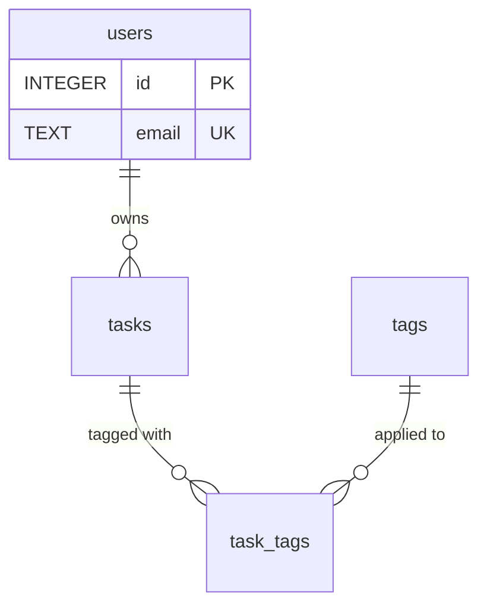

# M06 — SQL Fundamentals with SQLite

**Week 3 · Days 1–2 · 6 hours**

Welcome. By the end of this module you will have designed your own relational database,
written the SQL to create and query it by hand, and broken — then fixed — a real SQL
injection. All of it against **SQLite**: one file, free tools, nothing to install beyond a
small command-line program.

**What you will produce:** a `users` / `tasks` / `tags` / `task_tags` schema you designed,
created, and seeded with SQL; **20+ graded query exercises you wrote yourself**, including
explicit transactions; a working SQL-injection demo with evidence of both outcomes; and a
Mermaid ERD in your repository's README.

**How to read this material:**

- **▶ Concept** sections explain an idea *before* you touch the keyboard. Read top to bottom.
- **` ```sql ` blocks** are runnable fragments. Copy them into your session to try them —
  then change them, break them, and read the error.
- **Build it** boxes are the hands-on requirements. Everything inside one becomes part of
  your checkpoint evidence.
- **Troubleshooting** boxes appear where beginners actually get stuck. Stop at the first
  error and read it *before* searching — SQLite's error messages are good teachers.
- **Checkpoint** blocks (sections 1–9) are your self-test. Say the answer out loud; if you
  can't, re-read the section before moving on.

**Pace guide (6 hours):** §1 15m · §2 40m · §3 25m · §4 35m · §5 40m · §6 30m · §7 80m (the
long pole — 20+ of your own exercises) · §8 35m · §9 35m · §10 25m. Essentials-first: if you
run short, §7's *quantity* is the DoD — never trade exercises away for polish elsewhere.

**Tools:** required — the **sqlite3 CLI** (§3 covers installing it; DB Browser for SQLite is
an equal alternative wherever this material says "your tool"). Optional — a text editor.
Needed only in §9 — **Node.js ≥ 22.5** (any recent LTS works; check with `node --version`).

## 1. Introduction to Relational Databases and SQLite

- Understanding relational databases and how they organize data
- Understanding tables, rows, columns, and relationships
- Understanding SQLite's single-file database approach
- Understanding how M06 builds on the in-memory Task API from M05
- Understanding why the Task API needs a relational schema before introducing Prisma in M07
- Reviewing the M06 deliverables and learning objectives

A **relational database** stores data in **tables** — think spreadsheets with strict rules:
each table has fixed **columns** (fields, each with a type) and any number of **rows**
(records). What makes it *relational* is that tables reference each other: a row in `tasks`
can point at a row in `users` instead of copying the user's name into every task. Duplication
is the enemy; references are the fix.

Relationships come in degrees. One user *has many* tasks. One task *has many* tags, and one
tag *belongs to many* tasks. The second kind — many-to-many — cannot be answered with a
single reference column, and section 2 shows exactly why.

**SQLite** is a database engine that lives entirely inside your process and stores everything
in a **single file** (`task.db`). No server to start, no password, no configuration, no
Docker, no cost. That's why it's the one database this program touches hands-on: every
concept — keys, joins, indexes, transactions, injection — behaves the same in SQLite as in
PostgreSQL or MySQL, and you can delete the file and start over whenever you like.

**Where this sits in the Task API story.** In M05 you built Task API v1 with an *in-memory*
store: a JavaScript `Map` that lives only while the server runs. Restart the process and
every task is gone. There is no way to ask "all tasks owned by Alice, tagged urgent, sorted
by due date" without hand-writing loops. A relational database is the durable, queryable
replacement — and M07 replaces our hand-written SQL with **Prisma**, an ORM that *generates*
SQL from a schema file. Learning SQL first is deliberate: an ORM hides these mechanics, and
an ORM user who can't read what it hid cannot debug what it does.

**Deliverables and learning objectives** (your DoD for this module):

1. A four-table schema — `users`, `tasks`, `tags`, `task_tags` — with constraints and
   foreign keys you can explain, created and seeded with SQL.
2. **20+ graded query exercises you wrote yourself**, covering filtering, sorting and
   pagination, `INNER`/`LEFT` joins, aggregates with `GROUP BY`/`HAVING`, and at least one
   subquery — each with a stated expected result you check yourself against.
3. At least one query inside an explicit transaction (`BEGIN`/`COMMIT`/`ROLLBACK`).
4. A SQL-injection demo: the attack **succeeds** against a vulnerable query, and the
   parameterized fix **blocks** it — shown with captured evidence, not asserted.
5. A Mermaid ERD in your repository's README that matches the schema you actually built.

Objectives: you will be able to explain primary vs. foreign keys, index purpose, and how to
model 1:N vs. M:N — unaided, out loud — at the §10 self-assessment.

**Build it (§1):** write down the five deliverables above in your own words (a scratch file
is fine) and keep it beside you — §10 reviews this list line by line.

> **Troubleshooting — "which folder am I supposed to work in?"**
> Your practical work (SQL files, database, README) goes in the shared practical repository,
> in `modules/m06-sql-fundamentals-sqlite/`. Your written reflections go in the training
> documentation repo's matching folder. Keep the two straight: code and evidence in one,
> prose in the other.

**Checkpoint:** Explain why the Task API is moving from an in-memory store to a relational database.

## 2. Tables, Keys, Relationships, and Normalization

- Understanding primary keys and foreign keys
- Understanding one-to-one (1:1), one-to-many (1:N), and many-to-many (M:N) relationships
- Understanding why many-to-many relationships require a junction table
- Introducing normalization and its purpose
- Understanding the basics of First, Second, and Third Normal Forms (1NF, 2NF, and 3NF)
- Identifying the relationships between users, tasks, and tags
- Understanding how the `task_tags` table connects tasks and tags

**Primary keys and foreign keys.** Every table needs a **primary key (PK)** — the column that
uniquely identifies a row, never NULL, never repeated. In SQLite, `INTEGER PRIMARY KEY` is
the special one: it automatically numbers rows (1, 2, 3 …) and lookup by PK is instant.
A **foreign key (FK)** is a column in *another* table that holds a valid PK value — it's the
"reference" in "tables reference each other": `tasks.user_id = 4` means *this task belongs to
user 4*. The database can then enforce the reference (no task with user_id 99 unless user 99
exists) and follow it in queries (join).

**The three relationship degrees:**

| Degree | Example | Where the key lives |
| --- | --- | --- |
| 1:1 | a user ↔ their profile row | FK with a `UNIQUE` constraint (at most one match) |
| 1:N | a user → many tasks | FK on the *many* side: `tasks.user_id` |
| M:N | tasks ↔ tags | **neither side** — needs a third table |

**Why M:N requires a junction table.** Put `tag_id` on `tasks`? Then a task has at most one
tag. Put `task_id` on `tags`? Then a tag sits on at most one task. Both are 1:N models
pretending to be M:N. The relationship *itself* must become a table — `task_tags` — whose
rows are pure connections: `(task_id, tag_id)`. One row = "task X has tag Y". Six tasks with
three tags each? Eighteen junction rows — one per pair — and zero duplication of task or tag
data. The junction table
is the defining artifact of M:N modeling.

**Normalization** is the discipline of removing duplication so that every fact is stored
exactly once. Two test questions do most of the work: *does any column hold more than one
value?* and *if this value changes, must I update many rows?* The three normal forms ask
those questions in increasing depth.

**1NF (First Normal Form)** asks the first question directly: every cell holds one atomic
value. A `tags` column holding `"work,urgent,errand"` violates 1NF — three values wearing
one column's clothes — and so does a spread of `tag_id_1, tag_id_2, tag_id_3` columns that
must be widened every time a task gains a tag. Both are the disease; the junction table you
met above is the cure.

**2NF** takes the second question deeper: when a primary key is made of several
columns, no other column may depend on only *part* of that key. Our design barely engages
it — every table but the junction uses a single-column auto-id — but `task_tags(task_id,
tag_id)` is a clean example of obeying it: the table holds nothing *but* its two key
columns, so nothing there can depend on a part of the key.

**3NF** is the form you will feel in practice: no column may depend on anything other than
the key. Picture a `tasks` row storing its owner's email alongside `user_id`. Changing
Alice's email would then mean updating all of her tasks — one fact in two homes, and they
drift apart the first time only one is touched. The owner's email belongs in `users`; the
task keeps only the reference. That single rule is why `tasks` holds `user_id` and not user
data — and why the rest of this module's schema looks the way it does.

**Our domain, identified:** a user *owns* many tasks (1:N — FK on `tasks.user_id`); a task
*carries* many tags and a tag *appears on* many tasks (M:N — junction `task_tags`); users and
tags don't reference each other at all. `task_tags` connects tasks and tags by holding only
the two PKs involved — nothing else belongs there until the relationship itself gains
attributes (assignment time, tag weight — we don't need any yet).

**Build it (§2):** on paper or in a scratch file, sketch the four tables as boxes with their
PK and FK columns, and write one sentence per relationship naming its degree and which side
carries the key. You will refine this in §4 — paper first, SQL much later.

**Checkpoint:** Explain the relationships between the four required tables and why `task_tags` is needed.

## 3. Getting Started with SQLite

- Installing and choosing between the SQLite CLI and DB Browser for SQLite
- Creating and opening a SQLite database file
- Understanding SQLite's dynamic typing and type affinity
- Enabling foreign-key enforcement with `PRAGMA foreign_keys = ON`
- Inspecting tables, schema definitions, and stored data
- Executing SQL statements and reviewing their results

**Install your tool.** Two free options — either is fine, pick one:

- **sqlite3 CLI** (used in this material's examples): Windows — `winget install SQLite.SQLite`
  or download the `sqlite-tools-win-x64` zip from `sqlite.org/download.html` and put
  `sqlite3.exe` somewhere on your PATH; macOS — it's preinstalled; Linux —
  `sudo apt install sqlite3`. Verify: `sqlite3 --version`.
- **DB Browser for SQLite** (`sqlitebrowser.org`): a graphical app — double-click the
  `.db` file, browse tables in tabs, run SQL in the "Execute SQL" pane.

> **Troubleshooting — `choco install sqlite` fails with a permission/lock error**
> Chocolatey needs admin rights it may not have on a managed machine. The zip route above
> needs none: download, extract, add the folder to PATH (or use `winget`). Any of the three
> routes satisfies "free tool"; the brief allows the CLI *or* DB Browser.

**Create and open a database file.** From your module folder:

```bash
sqlite3 task.db
```

That's the whole installation of a database — if `task.db` didn't exist, it exists now
(a file, created on first write). You're at a `sqlite>` prompt. `.quit` exits; the file
remains. `.help` lists dot-commands (CLI conveniences — they start with `.`, they are *not*
SQL).

**Dynamic typing and type affinity.** SQLite lets a `TEXT` column hold a number and vice
versa — it doesn't stop you. **Type affinity** is SQLite's compromise: a column *declared*
`INTEGER` prefers integers (stores `42`, not `'42'`), `TEXT` prefers strings, and so on —
"preference," not enforcement. This surprises people coming from strict databases. The
practical consequence: **your declared types still matter**, because every other tool (and
M07's Prisma) reads them, and comparisons behave differently for `'10' < '9'` (true — text
order) than `10 < 9` (false). Declare honestly: `INTEGER` for ids and counts, `TEXT` for
names, ISO dates, and JSON.

**Enabling foreign-key enforcement — the rule, stated once, here:**

> SQLite has foreign keys **off by default in every new connection**. `PRAGMA
> foreign_keys = ON;` turns them on **for the current session only** — it does not save,
> does not persist, and does not carry over. Every new `sqlite3 task.db` session starts
> with enforcement OFF again. Re-run the PRAGMA in every session before any DML you want
> protected. This is not a quirk to memorize and forget — it is the single most silent
> failure mode in this module (§5 and §6 depend on it; §10's evidence depends on it).

```sql
PRAGMA foreign_keys = ON;
PRAGMA foreign_keys;      -- read it back: 1 means ON, 0 means OFF
```

**Inspecting tables, schema, and data** — your four essential dot-commands:

```sql
.tables              -- which tables exist
.schema tasks        -- the exact CREATE TABLE statement for one table
.headers on          -- print column names above result rows
.mode column         -- align columns; readable output
SELECT * FROM tasks; -- there are no tables yet — expect: no such table: tasks
```

That last error is your first success: it proves you're talking to an *empty* database, not
a missing tool.

**Executing statements:** SQL statements end with `;` — you can span lines, and the prompt
changes to `...` until you type it. A dot-command (`.tables`) executes immediately and needs
no semicolon. Mixing them freely in one session is normal.

**Build it (§3):** create `task.db` in your module folder; run `PRAGMA foreign_keys = ON;`
and read it back with `PRAGMA foreign_keys;`; run `.tables` (empty is expected); execute a
`SELECT` against a not-yet-existing table and read its error; then `.quit` and reopen —
observe the PRAGMA is back to 0. That observation *is* the lesson.

**Checkpoint:** Create a database file, execute a SQL statement, and verify the result using the chosen SQLite tool.

## 4. Designing the Task API Database Schema

- Translating the Task API domain into relational tables
- Designing the `users` table
- Designing the `tasks` table and its relationship to users
- Designing the `tags` table
- Designing the `task_tags` junction table
- Choosing appropriate columns, data types, and constraints
- Understanding how primary keys and foreign keys maintain relationships
- Planning the schema before writing the SQL

**Translating the domain.** The M05 Task API had tasks with `title`, `description`, `status`.
M06's schema grows the domain: tasks are *owned* by users and *tagged* by tags. Translate
nouns to tables, adjectives to columns, "belongs to" to FKs, "has many" to the *other* table's
FK:

| Domain fact | Schema decision |
| --- | --- |
| a user owns many tasks | `tasks.user_id` FK → `users.id` (1:N, key on the many) |
| a task carries many tags; a tag sits on many tasks | junction `task_tags(task_id, tag_id)` |
| task has a status from a fixed set | `TEXT` + `CHECK (status IN (…))` — SQLite has no enum |
| task may have no due date | nullable `due_date TEXT` — ISO dates sort correctly as text |
| titles must not repeat *within an owner* | `UNIQUE (user_id, title)` — composite |

Work through the four tables in dependency order — each one leans on the ones before it.

**Designing `users`:** `id` (PK), `name`, `email` (must be unique — `UNIQUE`),
`password_hash` (yes, a hash — never a plaintext password, and we only pretend-hash in this
module), `created_at` with a `DEFAULT`.

**Designing `tasks`:** `id` (PK), `user_id` (FK → users, `NOT NULL` — a task with no owner
isn't in our domain), `title`, `description`, `status`, `due_date` (nullable),
`created_at`/`updated_at` with `DEFAULT`s.

**Designing `tags`:** `id` (PK), `name` (`UNIQUE` — two tags both called "urgent" are the
same tag), `created_at`.

**Designing `task_tags`:** exactly two columns, `task_id` and `tag_id`, both FKs, both
`NOT NULL`, and — the key decision — a **composite primary key `(task_id, tag_id)`**. The
pair itself is the identifier: same task + same tag can never appear twice, and (because a
PK implies `NOT NULL`) neither column may be empty. You do **not** additionally need
`UNIQUE(task_id, tag_id)` or `NOT NULL` clauses — the PK implies both. An `id` surrogate
would need *three* clauses to reach the same rule (a `UNIQUE (task_id, tag_id)` plus an
explicit `NOT NULL` on each column — SQLite's `UNIQUE` does not imply `NOT NULL`); the
composite PK states it once.

**Choosing columns, types, and constraints.** You have already met this vocabulary by
example; here it is as a working set, each term with its job. Types: `INTEGER` for ids and
counts; `TEXT` for everything string-like, including ISO dates — `'2026-10-22'` compares
chronologically because text order *is* date order in that format. A value that must be
present gets `NOT NULL`; a column no two rows may share a value in gets `UNIQUE`, on one
column (our `email`) or on a pair (`UNIQUE (task_id, tag_id)`). A fixed set of allowed values gets
`CHECK (expr)` — SQLite has no enum type, so our `status` rule lives there. Values the
database can fill in for you get a `DEFAULT` (our timestamps). And a reference gets
`FOREIGN KEY (col) REFERENCES other (id) ON DELETE …`, which declares both the relationship
*and* what deletion should mean — §5 makes that choice explicitly.

**How PK and FK maintain relationships.** The PK guarantees "row 4 is row 4." The FK
guarantees *referential integrity*: with enforcement on (§3's PRAGMA), `tasks.user_id = 99`
fails unless user 99 exists — no phantom owners. And when a parent is deleted, `ON DELETE`
decides whether children are orphaned, removed, or protected (§5). Together they make the
relationship a *constraint the database enforces*, not a convention everyone remembers.

**Plan before SQL.** Four tables, their columns, keys, and FK actions — written down — before
any `CREATE TABLE`. Schema design errors discovered after seeding cost ten times what they
cost on paper.

> **Design decision you inherit from the trainer's reference:** title uniqueness is
> `UNIQUE (user_id, title)` — *per-owner*. Two different users may both own a task called
> "Buy milk"; one user may not own it twice. Your seed in §6 will still keep **globally**
> unique titles, because Task API v1's duplicate-title rule (409) is global and your seed
> shouldn't contradict the API you already built. The per-owner rule is the relational truth
> for a multi-user future; the global rule stays the API's stricter rule.

**Build it (§4):** complete your schema design — all four tables, every column with its type,
every constraint, and every FK action chosen *and named* (CASCADE or RESTRICT, with your
reason for each). Write the `task_tags` composite PK explicitly. This design is the source
document your SQL must match — and your ERD in §10 must match both.

**Checkpoint:** Complete a schema design for all four tables and explain the relationships and key decisions.

## 5. Creating Tables and Enforcing Constraints

- Understanding Data Definition Language (DDL)
- Creating tables with `CREATE TABLE`
- Understanding and using `PRIMARY KEY`, `NOT NULL`, and `UNIQUE`
- Applying `CHECK` and `DEFAULT` constraints where appropriate
- Defining foreign keys and choosing suitable `ON DELETE` behavior
- Understanding how constraints protect data integrity
- Introducing schema changes with `ALTER TABLE`
- Understanding when `DROP TABLE` removes a table and its data
- Creating the tables in the correct order to respect foreign-key dependencies

**DDL** (Data Definition Language) is the SQL family that shapes the schema itself:
`CREATE`, `ALTER`, `DROP`. It's separate in every SQL culture from **DML** (Data
Manipulation Language — `INSERT`, `SELECT`, `UPDATE`, `DELETE`, section 6): DDL defines the
container, DML fills it. Running DDL is instant and, unlike DML, not wrapped in transactions
here — there's no "partially created table" to undo.

**`CREATE TABLE` with the constraint vocabulary**, using the simplest table as the worked
pattern:

```sql
CREATE TABLE tags (
    id         INTEGER PRIMARY KEY,
    name       TEXT    NOT NULL UNIQUE,
    created_at TEXT    NOT NULL DEFAULT CURRENT_TIMESTAMP
);
```

Read it column by column: `id` is the auto-numbered PK; `name` must be present *and* unique;
`created_at` fills itself in if you don't supply it. That's `PRIMARY KEY`, `NOT NULL`,
`UNIQUE`, and `DEFAULT` in five lines.

`CHECK` is where a fixed set of values lives (SQLite has no enum type):

```sql
status TEXT NOT NULL DEFAULT 'todo'
       CONSTRAINT ck_tasks_status CHECK (status IN ('todo', 'in_progress', 'done'))
```

Try it after creating your `tasks` table: `INSERT INTO tasks (user_id, title, status) VALUES
(1, 'x', 'finished');` → **CHECK constraint failed: ck_tasks_status**. Constraints aren't
lint — they reject data at the door.

**Foreign keys and choosing `ON DELETE`.** The clause sits inside the child table:

```sql
FOREIGN KEY (user_id) REFERENCES users (id) ON DELETE CASCADE
```

The choice is a *policy question*, per relation — ask "what should happen to the children
when the parent disappears?" for each of our three FKs:

| FK | Action | Reasoning |
| --- | --- | --- |
| `tasks.user_id` → `users.id` | **CASCADE** | a deleted user's tasks are orphaned junk — remove them (their junction rows go too, two hops down) |
| `task_tags.task_id` → `tasks.id` | **CASCADE** | a junction row without its task means nothing |
| `task_tags.tag_id` → `tags.id` | **RESTRICT** | a tag still attached to tasks *cannot* be deleted — no silent rewriting of other people's tasks; an unused tag deletes fine |

CASCADE *deletes with*, RESTRICT *refuses to delete*. The other options (`SET NULL`,
`SET DEFAULT`, `NO ACTION`) exist; these two are the ones this design needs, chosen
deliberately rather than by habit.

**How constraints protect integrity** — make them prove it. After creating your tables (and
§3's PRAGMA, in this session):

```sql
INSERT INTO tasks (user_id, title) VALUES (999, 'phantom owner');  -- FK: no such user
INSERT INTO tasks (user_id, title) VALUES (1, NULL);               -- NOT NULL: title missing
```

Both must be rejected — with enforcement on. (If the first one *succeeds*, re-read the §3
PRAGMA rule. Silent enforcement-off is the trap this module keeps naming.)

**`ALTER TABLE`** in SQLite is deliberately narrow: `RENAME TO`, `ADD COLUMN`,
`RENAME COLUMN`. You *cannot* change a column's type, drop a column with a constraint, or
alter a FK through it. That narrowness is teachable honesty — schema mistakes that can't be
altered are rebuilt: create a new table, copy rows, drop old, rename (a standard SQLite
pattern; you don't need it this module, but know it exists instead of believing `ALTER`
always suffices).

**`DROP TABLE`** removes the table *and every row in it* — `DROP TABLE tasks;` is not
undoable outside a transaction. It also interacts with your other tables: dropping `users`
while `tasks` still references it fails (or cascades, depending on PRAGMA state and action —
the §3 enforcement rule applies to DDL-adjacent behavior too). The safe habit for full resets
is a schema script that drops in **reverse dependency order**: `task_tags` first, then
`tasks`, `tags`, `users` — children before parents.

**Creating tables in the correct order.** Forward: `users` (no FKs) → `tasks` (needs users)
→ `tags` (no FKs) → `task_tags` (needs *both* `tasks` and `tags`). SQLite actually lets you
create a table whose FK references a not-yet-existing table — the reference is only checked
at DML time — but *seeding* in creation order is where wrong order will absolutely fail.
Forward order for creation and inserts; reverse order for drops. One rule, both directions.

**Build it (§5):** create all four tables from your §4 design, in dependency order, then
verify: run `.schema` and confirm every constraint from your design appears — PKs (including
the composite), `NOT NULL`s, `UNIQUE`s, your `CHECK`, both `ON DELETE` actions. Insert one
deliberately invalid row per constraint type and confirm each is rejected. Save the
`.schema` output — it's checkpoint evidence, and §10's ERD must match it.

> **Troubleshooting — `FOREIGN KEY constraint failed` on your very first insert**
> Almost always one of: (1) the parent row doesn't exist yet — insert order (parents first);
> (2) your new session forgot §3's `PRAGMA foreign_keys = ON` — without it you'd actually
> see the *opposite* (inserts silently succeed), so a failure here means enforcement is on
> and the data is wrong; (3) you're testing the RESTRICT tag FK with a tag that's still in
> use — that error means it's *working*.

**Checkpoint:** Create all four tables and verify that the intended constraints and foreign-key relationships are present.

## 6. Seeding Data and Performing CRUD Operations

- Inserting records with `INSERT`
- Understanding how to insert related records in the correct order
- Seeding the database with users, tasks, and tags
- Updating existing records with `UPDATE`
- Deleting records with `DELETE`
- Retrieving records with `SELECT`
- Understanding how constraints affect invalid inserts and updates
- Verifying that the seeded data respects the schema's relationships

**`INSERT`** adds rows. Column list first, then matching values — one row or many:

```sql
INSERT INTO users (id, name, email, password_hash)
VALUES (1, 'Alice Nguyen', 'alice@example.com', 'scrypt$alice$fakehash001');

INSERT INTO tasks (id, user_id, title, status) VALUES
    (1, 1, 'Buy milk',        'todo'),
    (2, 1, 'Write sprint report', 'in_progress');
```

Explicit ids make your exercises' expected answers stable; `created_at` fills from the
`DEFAULT`.

**Insert order for related records** — §5's forward order, now load-bearing: `users` →
`tasks` / `tags` → `task_tags` **last**, because each junction row needs both its task and
its tag to already exist. A junction insert before either parent fails with `FOREIGN KEY
constraint failed` — the database enforcing the design for you.

**Seeding** is writing your dataset as a repeatable SQL script. Requirements for yours —
**shape beats volume**; every row below exists to make some exercise answer interesting:

- **4 users**, where **one has zero tasks** (so `LEFT JOIN` shows a real unmatched row).
- **~18 tasks**: mixed `status` values, explicit ids and a spread of `created_at`, `due_date`
  a mix of ISO dates **and NULLs** (so `IS NULL` and date filters matter), titles
  **globally unique** (the §4 inherited decision), and **≥2 tasks with no tags at all**.
- **~7 tags**, one of which is **never used** (so "count per tag" includes a zero, and
  `HAVING` has something to exclude).
- **~30 `task_tags` rows**, several tasks carrying multiple tags (the M:N must be visible),
  built from pairs you've verified exist.

```sql
INSERT INTO task_tags (task_id, tag_id) VALUES   -- both parents exist by now
    (1, 2), (1, 4),        -- one task, two tags: M:N in three lines
    (2, 1);
```

**`UPDATE` and `DELETE`** — always start with a `WHERE` you trust:

```sql
UPDATE tasks SET status = 'done', updated_at = CURRENT_TIMESTAMP WHERE id = 1;
DELETE FROM tasks WHERE id = 3;
```

An update *without* `WHERE` changes every row — run it by accident once in a throwaway
database and feel why `WHERE` comes first. `DELETE FROM tasks WHERE user_id = 1;` on a
Cascade parent is the cleaner alternative: the DB removes matching tasks *and* their junction
rows for you.

**`SELECT`** retrieves — the full CRUD "R":

```sql
SELECT id, title, status FROM tasks WHERE status = 'todo' ORDER BY id;
```

**How constraints affect invalid inserts and updates** — the three failure shapes you should
be able to provoke and name on sight:

```sql
INSERT INTO users (id, name, email) VALUES (9, 'NoMail', 'not-an-email');
-- CHECK constraint failed: ck_users_email   (our email shape rule)

INSERT INTO tasks (user_id, title) VALUES (1, 'Pay electricity bill');
-- UNIQUE constraint failed: tasks.user_id, tasks.title   (that owner already has this title)

UPDATE tasks SET status = 'finished' WHERE id = 1;
-- CHECK constraint failed: ck_tasks_status   (not in the allowed set)
```

Each error is the schema defending a decision *you* made in §4. If an invalid statement
*succeeds*, your constraint is missing or enforcement is off — either way, stop and fix it
before seeding further.

**Verifying seeded data respects the relationships:**

```sql
PRAGMA foreign_key_check;      -- must return ZERO rows: no dangling references
SELECT COUNT(*) FROM tasks;    -- matches your planned counts
SELECT user_id, COUNT(*) FROM tasks GROUP BY user_id;  -- per-owner counts, incl. 0s later
```

`foreign_key_check` is the seed's graduation paper — it scans for any reference that doesn't
resolve, regardless of when it was inserted.

**Build it (§6):** write `seed.sql` meeting every shape requirement above; run it against a
fresh schema; demonstrate one successful `UPDATE` and one `DELETE` (restore afterwards, or
rebuild); provoke all three constraint errors above (adapted to *your* tables — the last two
need a user id and title that already exist in *your* seed); run `PRAGMA foreign_key_check`
and capture the empty result. Keep your planned counts written down — §10 reviews them.

> **Troubleshooting — `database is locked`**
> Two sessions hold write access: an interactive `sqlite3` session with an unfinished
> statement (your prompt may be sitting on `...` waiting for a `;`), or a second tool (DB
> Browser) holding the file. Finish or `.quit` the first session; SQLite allows many readers
> but one writer.

**Checkpoint:** Seed the database and demonstrate successful CRUD operations while confirming that constraints prevent invalid data.

## 7. Querying Relational Data

- Filtering records with `WHERE`
- Combining conditions with `AND`, `OR`, and other comparison operators
- Sorting results with `ORDER BY`
- Limiting and paginating results with `LIMIT` and `OFFSET`
- Understanding the concept of keyset pagination
- Joining related records with `INNER JOIN`
- Including unmatched records with `LEFT JOIN`
- Using aggregate functions such as `COUNT`, `SUM`, `AVG`, `MIN`, and `MAX`
- Grouping results with `GROUP BY` and filtering groups with `HAVING`
- Using subqueries to answer questions involving related data
- Writing queries across users, tasks, tags, and the `task_tags` junction table
- Creating and running at least 20 of your own graded SQL query exercises
- Checking query results against the expected behavior of the data

This section is technique *and* the bulk of your deliverable. Each topic gets a worked
fragment — **your job is to write your own variations**, graded, until you have 20+.

**Filtering with `WHERE`, and combining conditions.**

```sql
SELECT id, title FROM tasks WHERE status = 'todo' AND due_date <= '2026-10-25';
SELECT id, title FROM tasks WHERE status IN ('todo', 'in_progress');
SELECT id, title FROM tasks WHERE title LIKE '%milk%';
```

`AND`/`OR` bind with **three-valued logic**: a `NULL due_date` is neither true nor false —
it's *unknown* — so the first query silently skips every task without a due date. Use
`WHERE due_date IS NULL` to find those; `= NULL` never matches anything, ever.

**Sorting with `ORDER BY`** — `ASC` (default) or `DESC`, multiple keys for tie-breaks:

```sql
SELECT id, status, due_date FROM tasks ORDER BY status, due_date, id;
```

Add the PK as the final key and ordering becomes fully deterministic — which is what makes
expected answers checkable. Note `NULL`s sort first in SQLite's ascending order.

**`LIMIT`/`OFFSET` pagination, and keyset pagination.**

```sql
SELECT id, title FROM tasks ORDER BY id LIMIT 5 OFFSET 5;   -- "page 2"
SELECT id, title FROM tasks WHERE id > 10 ORDER BY id LIMIT 5; -- keyset: rows after id 10
```

Offset paging *counts and discards* everything before the page — fine at 18 rows, wasteful at
a million (page 20,000 reads 100,000 rows to throw most away). **Keyset pagination** filters
on a *position* ("everything after the last row I saw") so the database **seeks** directly —
no counting, no drift when rows are inserted mid-browse. Know both; prefer keyset when the
list grows or live.

**`INNER JOIN` vs `LEFT JOIN`** — the single most productive hour of this module:

```sql
-- INNER: only rows that MATCH on both sides
SELECT u.name, t.title FROM users u
INNER JOIN tasks t ON t.user_id = u.id;

-- LEFT: every left-side row, even with no match (NULL-filled on the right)
SELECT u.name, t.title FROM users u
LEFT JOIN tasks t ON t.user_id = u.id;
```

Same query, one keyword apart: with your seed's zero-task user, `INNER` returns only users
who own tasks — the unmatched user **disappears**; `LEFT` keeps every user and shows `NULL`
where the match was missing. Row *counts* differ for the same reason (tagged tasks only vs.
all tasks, untagged ones NULL-filled). When a join "loses" or "duplicates" rows unexpectedly,
the INNER/LEFT choice plus junction fan-out is where to look first.

**Aggregates, `GROUP BY`, `HAVING`:**

```sql
SELECT COUNT(*) FROM tasks;                       -- whole-table aggregate
SELECT user_id, COUNT(*) AS n FROM tasks GROUP BY user_id;         -- one row PER group
SELECT tg.name, COUNT(*) FROM tags tg
LEFT JOIN task_tags tt ON tt.tag_id = tg.id
GROUP BY tg.id
HAVING COUNT(tt.task_id) > 2;                     -- filter GROUPS (post-grouping)
```

`COUNT`, `SUM`, `AVG`, `MIN`, `MAX` collapse rows to a number — `COUNT(col)` skips NULLs
where `COUNT(*)` counts rows, a difference your zero-task/untagged seed data makes visible.
`WHERE` filters *before* grouping; `HAVING` filters *after* — `HAVING` is how you ask about
the results of an aggregate (only tags used more than twice).

**Subqueries** — a query inside a query:

```sql
SELECT id, title FROM tasks
WHERE id IN (SELECT task_id FROM task_tags
             WHERE tag_id = (SELECT id FROM tags WHERE name = 'urgent'));

SELECT u.name FROM users u
WHERE NOT EXISTS (SELECT 1 FROM tasks t WHERE t.user_id = u.id);
```

The first nests an ordinary subquery (`IN` set membership); the second is **correlated** —
the inner query references `u` from the outer row and re-runs per user, which is exactly how
you ask "which users have no tasks?" (answer with your seed: the zero-task user).

**Across all four tables** — the junction in the middle of everything:

```sql
SELECT u.name, t.title, tg.name AS tag
FROM users u
JOIN tasks t      ON t.user_id = u.id
JOIN task_tags tt ON tt.task_id = t.id
JOIN tags tg      ON tg.id = tt.tag_id
ORDER BY u.name, t.title;
```

**Graded exercises: the format and the bar.** Each exercise is a question, your SQL, and a
`GRADED:` comment stating the exact expected result — *written before you run it*:

```sql
-- Q__. How many tasks does each owner have? Write the answer you EXPECT first.
SELECT user_id, COUNT(*) FROM tasks GROUP BY user_id;
-- GRADED: 3 rows — only owners WITH tasks appear; a GROUP BY over tasks cannot
-- invent the zero-task user. To count them as 0: FROM users LEFT JOIN tasks …
```

Write the `GRADED:` line first, run, then diff reality against it — an expectation that
doesn't match is a *bug in your query, your seed, or your understanding*, and finding which
is the exercise. (This is also how your trainer's own set caught two real defects: an
integrity check silently off, and a wrong expected count.)

**Coverage your 20+ must include** (roughly — you choose your own questions):

| Category | Min | Your Q#s |
| --- | --- | --- |
| filtering (`WHERE`, `AND/OR`, `LIKE`, `IS NULL`) | 3 | |
| sorting + pagination (incl. `LIMIT/OFFSET` **and** keyset) | 3 | |
| `INNER JOIN` **and** `LEFT JOIN` | 4 | |
| aggregates with `GROUP BY` **and** `HAVING` | 3 | |
| subqueries (at least one **correlated**) | 2 | |
| `UPDATE` / `DELETE` with verification | 2 | |
| indexes + `EXPLAIN QUERY PLAN` before/after | 2 | |
| transaction (`BEGIN`/`COMMIT` and `ROLLBACK`) | 2 | |

**Build it (§7):** write and run **at least 20 of your own graded exercises** against your
own seeded schema — the category minimums in the table above sum to 21, so covering every
row puts you comfortably over the DoD's 20. Keep them in `exercises.sql` in
numbered order with `GRADED:` comments. Every expectation must match on a fresh run.

> **Troubleshooting — "my join returned 16× the rows I expected"**
> That's junction fan-out: joining through `task_tags` produces one row per (task, tag) pair,
> so a task with 4 tags appears 4 times — and joining two junction-style tables multiplies.
> Count with `COUNT(DISTINCT t.id)` when you want *tasks*, not pairs, and decide
> deliberately which grain you mean.
>
> **Troubleshooting — a returned row "disappeared" after a join**
> You used `INNER` where you needed `LEFT` (unmatched rows were dropped) — or you filtered
> the right side in `WHERE` instead of in the `ON` clause, which turns a `LEFT` join back
> into an `INNER` one (a `NULL`-filled right column fails `WHERE`, removing the row).

**Checkpoint:** Complete at least 20 of your own graded query exercises against your schema, covering filtering, sorting, pagination, `INNER JOIN`, `LEFT JOIN`, aggregates with `GROUP BY` and `HAVING`, and at least one subquery.

## 8. Indexes, Query Plans, and Transactions

- Understanding what an index is and why it can improve query performance
- Identifying queries that may benefit from indexes
- Creating and removing indexes with `CREATE INDEX` and `DROP INDEX`
- Inspecting query plans with `EXPLAIN QUERY PLAN`
- Understanding the basic ACID properties of transactions
- Starting transactions with `BEGIN`
- Saving changes with `COMMIT`
- Reverting uncommitted changes with `ROLLBACK`
- Understanding when multiple database operations should succeed or fail together
- Trying at least one query or set of database operations inside an explicit transaction

**What an index is.** A B-tree — a sorted structure over chosen columns — that lets the
engine *navigate* to matching rows instead of reading the whole table. Without one:
`SCAN` (every row). With one: `SEARCH … USING INDEX` (walk the tree). The price: every
`INSERT`/`UPDATE`/`DELETE` must also maintain each index covering the touched columns. An
index is a bet that reads on this column outweigh writes to it.

**Identifying queries that benefit:** anything you repeatedly `WHERE` on, `JOIN` on, or
`ORDER BY` — especially FK columns (joins to parents) and status/tag-style filters you query
by. If you measure the same scan twice, that's your candidate. (Our schema pre-builds only
the FK join paths; the status filter is left bare on purpose — below, you build it and watch
the plan change.)

**`CREATE INDEX` / `DROP INDEX`:**

```sql
CREATE INDEX idx_tasks_status ON tasks (status);
DROP INDEX idx_tasks_status;
```

**`EXPLAIN QUERY PLAN`** — read the engine's own account, before *and* after:

```sql
EXPLAIN QUERY PLAN SELECT id, title FROM tasks WHERE status = 'todo';
-- QUERY PLAN: `--SCAN tasks            ← no index: every row is read

CREATE INDEX idx_tasks_status ON tasks (status);
EXPLAIN QUERY PLAN SELECT id, title FROM tasks WHERE status = 'todo';
-- QUERY PLAN: `--SEARCH tasks USING INDEX idx_tasks_status (status=?)
```

Two lines of output, one permanent lesson: `SCAN` vs `SEARCH` is the entire performance
conversation in miniature. (Re-run it after `DROP INDEX` to see the plan fall back.)

**ACID — the four properties transactions exist for:**

- **A**tomicity — all statements in the transaction happen or none do.
- **C**onsistency — each committed state satisfies every constraint (the DB never lands
  half-valid).
- **I**solation — concurrent transactions don't see each other's half-done work.
- **D**urability — once `COMMIT` returns, it survives a crash.

**`BEGIN` / `COMMIT` / `ROLLBACK`** — the statements that drive it:

```sql
BEGIN;
UPDATE tasks SET status = 'todo' WHERE status = 'done';
SELECT COUNT(*) FROM tasks WHERE status = 'done';   -- sees the uncommitted change
ROLLBACK;                                           -- change never happened
```

Inside the transaction *you* see the pending change; after `ROLLBACK` it's gone. `COMMIT`
makes it durable instead. `ROLLBACK` is not failure — it's "changed my mind," and it's the
safest button in SQL.

**When multiple operations must succeed or fail together** — the reason transactions exist:
a transfer, an order + its line items, a task update + its tags. One `UPDATE` that half-
succeeds (or a `DELETE` whose child rows survive because enforcement was off — §3 again) is
a corrupt state; a transaction makes it unreachable. Rule of thumb: two writes that *mean
one business action* → one transaction.

**Build it (§8):** add at least two index exercises to `exercises.sql` (before/after plan on
the same query, `CREATE INDEX` in between); then write **two transaction exercises** — one
`BEGIN` → change → verify → `ROLLBACK` → verify reverted, and one `BEGIN` → changes →
`COMMIT` → verify durable — each with `GRADED:` expectations written first, as in §7. Save
both transcripts as evidence.

> **Troubleshooting — `cannot start a transaction within a transaction`**
> A previous `BEGIN` never closed — you're mid-transaction (maybe from an aborted experiment).
> Run `ROLLBACK;` to clear it, then start clean. The counterpart habit: never walk away from
> a session with an open transaction — it can hold a write lock on the file.

**Checkpoint:** Explain the purpose of an index, inspect a query plan, and demonstrate the behavior of `COMMIT` and `ROLLBACK`.

## 9. SQL Injection and Parameterized Queries

- Understanding how SQL injection happens
- Recognizing the risk of constructing SQL statements through string concatenation
- Writing a deliberately vulnerable query using concatenated input
- Demonstrating a successful SQL injection against the vulnerable query
- Understanding why the injected input changes the meaning of the SQL statement
- Rewriting the same query to use parameterized input
- Demonstrating that the same injection attempt no longer works as intended
- Comparing the vulnerable and parameterized versions
- Capturing evidence of both the successful injection and the fixed behavior

**How injection happens.** The application builds a SQL string by pasting user input into
its text. If the input is part of the *statement*, the SQL parser reads it as SQL — the user
is then writing queries with you. `SELECT … WHERE email = 'WHAT_THE_USER_TYPED'` looks
safe until the typed value is `' OR 1=1 -- `.

**The risk of string concatenation** — see the actual constructed statement:

```text
Input email:  ' OR 1=1 --
Built SQL:    SELECT id, name FROM users
              WHERE email = '' OR 1=1 -- ' AND password_hash = 'anything'
```

**Why the input changes the meaning:** the `'` closes the string early; `OR 1=1` is an
always-true condition; `--` starts a SQL comment that eats the rest of the line — including
your password check. The statement the parser now sees is logically *unconditional*. Not
because the database was fooled — because **the statement itself was rewritten by the
caller**. That's injection: input crossed from data into code because both shared one string.

**Writing the vulnerable query, and demonstrating success.** Parameter binding is an API
feature (a CLI can paste strings just as badly), so we run the demo in Node ≥ 22.5 using the
built-in `node:sqlite` — no installs. Save as `injection-demo.mjs`:

```js
import { DatabaseSync } from "node:sqlite";
const db = new DatabaseSync("task.db");          // your §6 seed, in this folder

// (1) VULNERABLE — input concatenated INTO the SQL text
const email = "' OR 1=1 -- ";
const vulnSql = `SELECT id, name FROM users WHERE email = '${email}' AND password_hash = 'x'`;
console.log("constructed:", vulnSql);
const rows = db.prepare(vulnSql).all();
console.log("rows:", rows.length);               // > 0 — login bypassed
```

Run `node injection-demo.mjs` and read the `constructed:` line — that printed statement is
your evidence that the input became SQL. **Expected: one or more rows returned — the attack
succeeded** (against our seed: every user, because the condition is unconditional).

**Rewriting with parameterized input — same conditions, `?` placeholders:**

```js
// (2) PARAMETERIZED — SQL text and values travel separately
const fixedSql = "SELECT id, name FROM users WHERE email = ? AND password_hash = ?";
const rows2 = db.prepare(fixedSql).all(email, "x");
console.log("rows:", rows2.length);              // 0 — payload matched no email

// (3) and a REAL user still gets in through the same fixed query
//     ← replace both values with an email + password_hash from YOUR seed
const rows3 = db.prepare(fixedSql).all("alice@example.com", "scrypt$alice$fakehash001");
console.log("rows:", rows3.length);              // 1 — legitimate login works
```

(`SELECT email, password_hash FROM users LIMIT 1;` hands you a real pair from your own
seed — without this step round 3 returns 0 and looks like a broken demo when it's just
someone else's data.)

`db.prepare(sql).all(params)` sends the template (parsed once, structure fixed) and the
values **separately** — the driver never re-parses values as SQL. The payload arrives as a
literal email string that simply matches nothing. This is the rule, stated once:

> Parameterized queries stop injection by **channel separation**, not filtering: SQL text
> and data are delivered through different paths, so input *cannot* be reinterpreted as
> code. Escape lists and blocklists guess at what attackers might try; parameters remove
> the interpretation step entirely — and round 3 of the demo matters: a *legitimate* login
> still returns 1 row, because parameters preserve intent and kill only misinterpretation.

**Comparing the versions** — capture both, side by side, in one transcript:
vulnerable: `constructed:` line + **rows > 0** (bypass); parameterized: same payload +
**rows = 0** (blocked); legitimate + parameterized: **rows = 1** (works). If your run shows
`rows: 0` for the vulnerable query first, check you're in the module folder (wrong/empty
`task.db`) before suspecting the attack.

**Capture evidence of both outcomes.** Save the full run output (`node injection-demo.mjs
> injection-evidence.txt` or paste into your evidence file): the vulnerable success *and* the
parameterized block, in the same artifact — one without the other proves nothing. Your §10
self-review requires this file.

**Build it (§9):** write `injection-demo.mjs` as above (or equivalent), run it, confirm the
three expected outcomes (bypass > 0, blocked = 0, legit = 1), and capture the transcript.
Then vary one thing and re-run to prove you understand — e.g. change the payload to
`' OR 'a'='a` and predict the vulnerable result *before* running.

> **Troubleshooting — `node:sqlite` not found / `ERR_UNKNOWN_BUILTIN_MODULE`**
> Your `node --version` is below 22.5 — upgrade Node, or (if you use fnm/nvm) switch to a
> current LTS and re-run. An `ExperimentalWarning: node:sqlite` line on stderr is *expected*
> and harmless — it is not the attack failing.

**Checkpoint:** Demonstrate that SQL injection succeeds against the vulnerable query and is blocked by the parameterized version, with evidence of both outcomes.

## 10. Final Integration, Documentation, and Self-Assessment

- Reviewing the complete database schema and seeded data
- Verifying that all four required tables and their relationships are correct
- Reviewing the 20+ SQL exercises and confirming their required coverage
- Confirming that at least one explicit transaction has been attempted
- Verifying the SQL injection demonstration and parameterized fix
- Documenting the database relationships with a Mermaid ERD in the GitHub repository's README
- Checking that the Mermaid ERD matches the actual schema
- Reviewing the module's completion requirements and preparing the pull request
- Explaining the difference between primary keys and foreign keys
- Explaining the purpose of indexes and the difference between 1:N and M:N relationships
- Reflecting on challenges, query-writing lessons, and schema design decisions
- Understanding how M06's SQL knowledge prepares you to use Prisma in M07

**Integration review — rebuild and replay from zero.** The strongest proof everything works:
`rm task.db`, re-run schema, re-run seed, re-run every exercise — all expectations still
matching. A database that only ever worked once, in one order, hasn't been verified.

- `PRAGMA foreign_key_check` → zero rows. `.schema` → every constraint from your §4 design.
- Counts match your seed plan (users / tasks / tags / junction rows).
- Coverage table from §7: every category filled, **≥20 exercises**, each `GRADED:` line
  matching on the fresh run.
- Transaction exercises present and correct (the §8 pair — `ROLLBACK` reverted, `COMMIT`
  durable).
- Injection transcript: bypass **and** block **and** legitimate login, all three.

**The Mermaid ERD in your README.** Mermaid renders on GitHub inside a fenced block tagged
`mermaid`. The vocabulary you need:



`||--o{` reads "one to many" (one `||`, many `o{`); `PK`/`FK`/`UK` flag the keys in each
entity block. Mermaid *cannot* draw a composite PK on two columns or a multi-column UNIQUE —
add a one-line note under the diagram for those (your junction's `(task_id, tag_id)` PK
needs exactly that).

**Checking the ERD matches the schema** — mechanically, not by eye: for each entity block,
diff its attribute list against `.schema` output — every column, type, PK/FK/UK flag, and
each FK relationship line against a real `FOREIGN KEY … REFERENCES` clause. Column missing?
Flag wrong? Diagram is the bug. (Diagram first-draft drift is the most common README defect
in this program — the check exists because eyes skim.)

**Preparing the pull request.** Files: `schema.sql`, `seed.sql`, `exercises.sql`,
`injection-demo.mjs` (or your equivalent), README with the ERD. Self-review against the DoD
below, write your PR description from your §7 coverage table and evidence file names, then
open it through your branch → PR → merge habit.

**Concept self-test — say these out loud, unaided:**

- *Primary key vs. foreign key:* PK = this row's unique identity (never NULL, never
  repeated); FK = a reference to *another* table's PK, enforcing that the referent exists.
- *What an index is for:* pre-sorted structure the engine navigates instead of scanning —
  faster reads, slower writes, chosen for columns you query by.
- *1:N vs. M:N:* one-to-many puts the key on the many side (one FK column); many-to-many
  can't — both sides are "many," so the relationship becomes its own junction table keyed by
  the pair.

**Reflection** — write the three you'd tell the next trainee: a challenge you hit (with the
error text), a query-writing lesson (an expectation that didn't match, and which of query /
seed / understanding was wrong), and one schema design decision you'd defend or change.

**M06 → M07 bridge.** Your hand-written SQL is about to become a Prisma schema file: tables
→ `model` blocks, `INTEGER PRIMARY KEY` → `@id @default(autoincrement())`, FKs → `@relation`
with your `onDelete` actions carried across verbatim (`Cascade` / `Restrict` — if you lose
one, behavior changes silently), `UNIQUE (user_id, title)` → `@@unique([userId, title])`,
your indexes → `@@index([…])`. What Prisma does *not* carry: a `CHECK` equivalent. SQLite
has CHECK — you have used it — but Prisma's schema DSL cannot express it on SQLite, so your
`status` rule must be re-expressed in application validation (arriving in M08), or it
silently evaporates in the migration. You now know exactly what the ORM will hide — which
is the entire point of doing SQL first.

**Trainee self-review (module DoD):**

- [ ] At least 20 of my own graded query exercises written and run against my own schema,
      covering: filtering, sorting and pagination, `INNER`/`LEFT` joins, aggregates with
      `GROUP BY`/`HAVING`, and at least one subquery.
- [ ] I can explain primary vs. foreign keys, what an index is for, and how to model 1:N
      vs. M:N — unaided.
- [ ] The SQL-injection demo actually succeeded against the vulnerable query, and the
      parameterised fix actually blocked it — evidence captured, both outcomes.
- [ ] A Mermaid ERD exists in my README and matches the schema I actually built.
