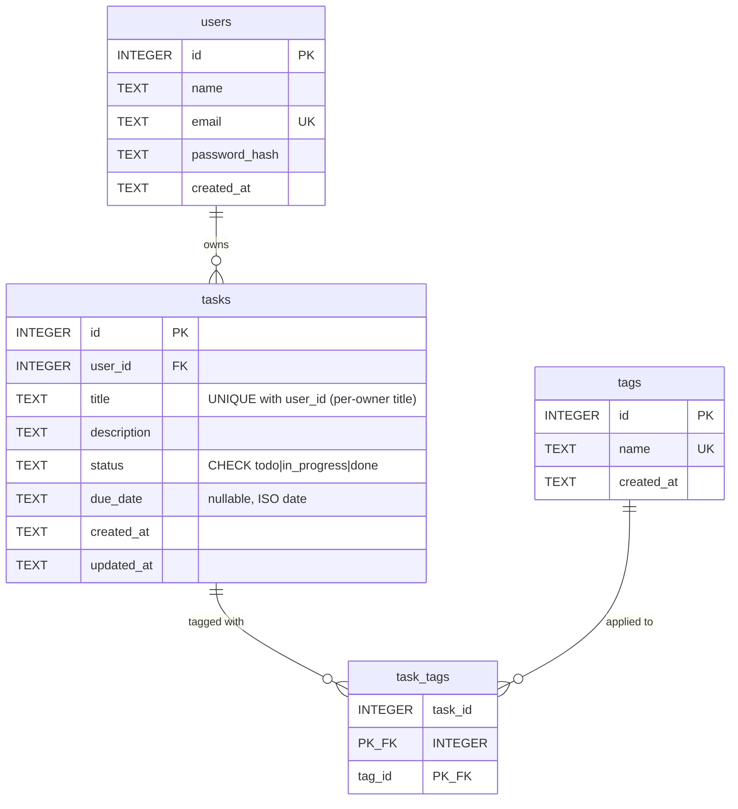

# M06 Write-Up — SQL Fundamentals with SQLite

> Filled from the actual build in `node-js-training-ground` (PR #11, merge `6ecdfbd`; title-rule
> follow-up PR #12, merge `f363b5b`). Environment: sqlite3 CLI **3.54.1** (official
> `sqlite-tools-win-x64` zip extracted to `~/.local/bin` — Chocolatey is admin-locked on this
> harness), Node **24.21.0** through `fnm exec --using=24 -- …`, `node:sqlite` built in, zero
> npm dependencies. This write-up is my M07 reference — schema, constraint names, and the
> Prisma handoff notes included for that reason.

## What I built

`modules/m06-sql-fundamentals-sqlite/` in the ground repo:

- `schema.sql` — DDL for the four tables, dropped-and-recreated in reverse dependency order so
  the file is re-runnable. `users` (id, name, email, password_hash, created_at),
  `tasks` (id, user_id, title, description, status, due_date, created_at, updated_at),
  `tags` (id, name, created_at), `task_tags` (task_id, tag_id). Constraint names worth
  remembering for M07: `ck_users_email`, `ck_tasks_status`,
  `uq_tasks_user_title UNIQUE (user_id, title)`, `fk_tasks_user` (ON DELETE CASCADE),
  `fk_task_tags_task` (CASCADE), `fk_task_tags_tag` (RESTRICT). Two indexes up front:
  `idx_tasks_user_id`, `idx_task_tags_tag_id`. `tasks.status` deliberately left unindexed.
- `seed.sql` — deterministic seed: **4 users / 18 tasks / 7 tags / 30 junction rows**, explicit
  ids and timestamps so ORDER BY/OFFSET answers are stable. Shaped as a teaching instrument:
  Dave has 0 tasks (real NULLs through LEFT JOIN), tag `someday` has 0 uses (HAVING over zero
  is non-vacuous), tasks 11/16 are untagged, `due_date` mixes NULL and ISO dates, every title
  globally unique (see the §2 decision).
- `exercises.sql` — **21 graded exercises**, run in order, each with a `GRADED:` comment
  stating the exact result required: Q1–Q3 filtering (incl. `IS NULL`), Q4–Q6 sorting +
  `LIMIT/OFFSET` + keyset, Q7–Q10 `INNER`/`LEFT JOIN`, Q11–Q13 `GROUP BY`/`HAVING`,
  Q14–Q15 subqueries (`IN`, correlated `NOT EXISTS`), Q16–Q17 `UPDATE`/`DELETE` + cascade
  proof, Q18–Q19 `EXPLAIN QUERY PLAN` before/after an index, Q20–Q21 `ROLLBACK`/`COMMIT`.
- `injection-demo.mjs` — self-verifying three-round login-bypass demo on `node:sqlite`: exit 0
  only if the vulnerable query is bypassed, the parameterised query blocks the same payload,
  AND a legitimate login still works through the parameterised query.
- `README.md` — quick start, the Mermaid ERD matching the schema, and the design decisions.

Evidence in `evidence/m06/` (gitignored, INDEX.md-indexed): `schema-apply.txt`,
`exercise-run.txt`, `injection-demo.txt`, `constraint-proofs.txt`.

Environment notes: `choco install sqlite` fails with a NuGet lock/permission error on this
machine, so the CLI came from the official zip (free, no admin, `~/.local/bin` already on
PATH). Fresh shells still default to Node 22 — every Node invocation went through
`fnm exec --using=24` (carried trap, still unfixed at shell level).

## Why it's built this way (key decisions)

- **The junction table's primary key IS the design.** `task_tags` is `(task_id, tag_id)` with a
  composite `PRIMARY KEY` and no surrogate id — because the thing that must never repeat is the
  *pair*, and a PK states exactly that while implying `NOT NULL` on both columns for free. An
  auto-id plus a `UNIQUE` on the pair would need three clauses to reach the same rule (the
  `UNIQUE`, plus a `NOT NULL` on each column — SQLite's UNIQUE does *not* imply NOT NULL); the
  composite PK says it once. FK actions are chosen per relation, not by habit:
  `task_id → CASCADE` (a junction row is meaningless without its task), `tag_id → RESTRICT`
  (a tag still attached to tasks cannot be deleted, while an unused one deletes fine — proven
  both ways in `constraint-proofs.txt`).
- **Title uniqueness: composite rule in the schema, globally unique seed.** This was the
  `[CARRY TO M06]` decision from the M05 retro, and I initially built it as seed rows proving
  cross-owner duplicates (two "Buy milk" tasks) — which contradicted M05's actual 409 rule,
  since its userless API rejects *any* duplicate title globally. Flagged mid-build; the
  resolution (owner-approved): schema keeps `UNIQUE (user_id, title)` (per-owner — the
  relational truth, maps to Prisma `@@unique([userId, title])` in M07), while the seed's
  titles are globally unique so no seed row ever contradicts the stricter API rule. The
  cross-owner allowance is proven live as **TEST 6** in `constraint-proofs.txt` instead of
  with data the API would reject. Net rule for M07: API stays globally strict, DB is
  per-owner permissive — API ⊂ DB, no conflict.
- **What I indexed, and what would change if I hadn't:** only the join-path columns —
  `idx_tasks_user_id` (every parent→child lookup in Q7/Q10/Q11) and `idx_task_tags_tag_id`
  (tag→task direction; the junction's own PK already covers task_id-first queries). Without
  them those lookups degrade from `SEARCH` to full `SCAN` — invisible at 18 tasks, linear cost
  as rows grow, which is exactly the scale at which a beginner can't feel it. That's why Q18/Q19
  make the before/after *visible*: `SCAN tasks` → `SEARCH tasks USING INDEX idx_tasks_status`.
  `status` stayed unindexed on purpose so that pair has something to build.
- **Surrogate `INTEGER PRIMARY KEY` everywhere** — it aliases SQLite's hidden `rowid` (compact,
  auto-generated, direct lookups) and is the shape Prisma's `@id @default(autoincrement())`
  expects, so M07's translation is mechanical rather than renegotiated.
- **The exercise that taught me something I didn't expect: Q17.** Not SQL — session state.
  The first full run graded `17|28` and printed `17|30`: `exercises.sql` runs on a *fresh*
  connection where `PRAGMA foreign_keys` defaults OFF, so `ON DELETE CASCADE` did nothing —
  silently, exit 0, no warning. The schema file's own warning applied to itself. Fixed with
  one line (`PRAGMA foreign_keys = ON` at the top, same as schema/seed), but the *silence* is
  the module's sharpest lesson: broken integrity enforcement looks exactly like working
  integrity enforcement until you count the rows.

## How to build it (teach it to the next trainee)

**Designing a junction table for a many-to-many relationship — the reasoning, using
`task_tags`:**

1. **Feel the failure first.** Try to put tags on a task the obvious way: a `tags` column on
   `tasks` holding `"work,urgent"` — violates 1NF (repeating values, no atomicity) — or
   `tag_id_1, tag_id_2, …` columns — invents an arbitrary maximum and makes "find all tasks
   with tag X" a scan over N half-empty columns. Both shapes are *1:N models pretending to be
   M:N*. The relationship itself is the problem: a task can have many tags **and** a tag can
   have many tasks — neither side can own the foreign key.
2. **So the relationship becomes its own table.** `task_tags(task_id, tag_id)`: each row is one
   *fact* — "this task has this tag" — not a record about a task or a tag. That's the mental
   flip. Two columns, no payload.
3. **Make the pair the primary key.** `PRIMARY KEY (task_id, tag_id)` — the same task can't
   carry the same tag twice, and neither column may be NULL. You do not also need
   `UNIQUE(task_id, tag_id)` or `NOT NULL` — the PK implies both. Add an `id` surrogate only if
   the junction will accumulate its own attributes and lifecycle; ours won't.
4. **Choose `ON DELETE` per side by asking what should survive.** Delete a task → its junction
   rows are orphan-junk → `CASCADE`. Delete a tag still in use → silently rewriting other
   people's tasks is hostile → `RESTRICT` (delete an unused tag → succeeds). Note this means
   deleting a user cascades tasks *and* those tasks' junction rows, two hops down.
5. **Insert in parent order.** `users` → `tasks`/`tags` → `task_tags` last, because both of its
   parents must already exist. Same order for reading, reversed for `DROP`.
6. **Query it in three shapes and know what each means:** `INNER JOIN` (only tagged pairs —
   30 rows), `LEFT JOIN` (every task, NULL where untagged — 32 rows; untagged tasks exist),
   `GROUP BY` over the junction (usage counts — a `LEFT JOIN` + `HAVING COUNT(...) > 0` turns
   "never used" into a visible zero instead of a missing row).
7. **Verify the design by trying to break it:** insert the same pair twice (PK error), delete
   an in-use tag (RESTRICT error), delete a task and count the junction (cascade, no orphans).
   If those three behave, the junction is right.

## Concepts worth explaining

- **Why parameterised queries stop SQL injection.** The vulnerable demo sends *one string* in
  which the attacker's input is pasted: `WHERE email = '${email}'`. The input is part of the
  SQL **text**, so the parser reads it as SQL — `' OR 1=1 -- ` closes the quote, adds an
  always-true branch, and comments out the password check. A parameterised query sends two
  things: the SQL *template* (`… WHERE email = ? AND password_hash = ?`, parsed once, structure
  fixed) and the *values* separately. The driver never re-parses values as SQL — the payload
  arrives as a literal string that simply matches no row. It's not a filter or an escape
  list (blocklists rot); it's a change of channel: data can't become code if they never share
  a parser. The demo's third round matters here too: a legitimate login still returns 1 row
  through the same parameterised query — parameters preserve intent and kill only
  *interpretation*.
- **What an index is for — pre-computed structure paid for on write.** A B-tree over chosen
  columns, sorted, so the engine finds rows by navigating instead of reading everything
  (`EXPLAIN QUERY PLAN`: `SCAN` vs `SEARCH … USING INDEX`). The cost side is real: every
  `INSERT`/`UPDATE`/`DELETE` also maintains each index — Q19 builds one and you should feel
  the trade-off in the wording: indexes are for columns you *query by*, and each one is a bet
  that reads beat writes for that column. That's why the schema pre-builds only the FK join
  paths (every read touches them) and leaves `status` for the exercise that proves its worth.

## What tripped me up

- **The silent FK-off session (Q17, above).** Biggest one: cascade *appearing* to work in the
  schema file's session, doing nothing in a fresh CLI session, exit 0 throughout. Constraint
  enforcement that fails silently is worse than an error — this now gets a troubleshooting
  block in the training material, and every SQL file self-asserts its own `PRAGMA`.
- **A graded-comment arithmetic error the run caught for me.** Q20's expected count said 4
  done tasks; the transcript said 5 — I'd forgotten Q16 flips task 5 to `done` earlier in the
  same ordered file. Writing expectations *before* running, then actually diffing against the
  transcript, caught what prose review wouldn't. (M05's "repro, don't trust prose" lesson,
  reapplied mechanically.)
- **`COUNT(*)` vs `COUNT(t.id)` with a LEFT JOIN.** Dave's "task count" came out as 1 with
  `COUNT(*)` — his single NULL-padded row still counts — and 0 with `COUNT(t.id)`. Both are
  defensible depending on intent; neither is obvious the first time. Teaching point: say which
  thing you're counting.
- **Three-valued logic ate my Q1 answer.** `status = 'todo' AND due_date <= '2026-10-25'`
  silently dropped every NULL due_date task (they're *unknown*, not false). Designed as a
  lesson, still a surprise in the moment — Q3 exists because of it.
- **The injection demo needed a language, not a shell.** Parameter binding is an API feature,
  so the `sqlite3` CLI couldn't demonstrate it — the demo moved to Node 24's `node:sqlite`
  (zero npm deps), whose ExperimentalWarning on stderr looks alarming until you know it's
  expected.
- **Tooling friction:** Chocolatey's admin lock (official zip instead — worth a line in any
  trainee setup notes: `choco install sqlite` may need elevation they don't have) and the
  carried fnm default-v22 probe.

## Checkpoint evidence

All in `evidence/m06/` (INDEX.md-indexed); claims below match the files:

- **21 graded exercises** (≥20 DoD) — `exercise-run.txt`, exit 0, every `GRADED:` comment
  matched after the two fixes: filtering ×3 (incl. `IS NULL`), sorting/pagination ×3 (offset
  **and** keyset), `INNER`/`LEFT JOIN` ×4, aggregates `GROUP BY`/`HAVING` ×3, subqueries ×2
  (`IN`, correlated `NOT EXISTS`), DML ×2, indexes + `EXPLAIN QUERY PLAN` ×2
  (`SCAN` → `SEARCH … USING INDEX idx_tasks_status`), transactions ×2 (`0` then `5` across
  `ROLLBACK`; committed row `19` after `COMMIT`).
- **Injection demo** — `injection-demo.txt`, one self-verifying run:
  vulnerable concat query constructed as
  `… WHERE email = '' OR 1=1 -- ' AND password_hash = 'irrelevant'` → **4 rows, login
  bypassed**; same payload parameterised → **0 rows, blocked**; legitimate login
  parameterised → **1 row**; `RESULT: PASS (vulnerable=4, parameterised-attack=0, legit=1)`.
- **Constraint proofs** — `constraint-proofs.txt`, 6/6 as designed: 0-task user deletes;
  cascade leaves **0 orphan junction rows**; in-use tag RESTRICT **exit 1**; unused tag
  deletes; duplicate per-owner title UNIQUE **exit 1**; cross-owner `'Buy milk'` insert
  **exit 0** (TEST 6 — the owner-decided rule, proven live).
- **Schema + seed** — `schema-apply.txt`: applies clean in one session, `PRAGMA
  foreign_key_check` empty, counts 4/18/7/30.
- **Mermaid ERD** matching the schema — in the ground `README.md` (§ "ERD matches
  schema.sql"); verified table-by-table against the live `.schema` dump: all 18 columns, 3
  FKs, the 4 PK declarations (three single-column plus the composite on `task_tags`), and
  all 3 UNIQUEs — `users.email` and `tags.name` carry the diagram's UK flags, and the
  composite `uq_tasks_user_title` is covered by the composite-key note below the diagram.

(Composite-key notes Mermaid can't draw: `task_tags` PK is `(task_id, tag_id)`; `tasks` has
`UNIQUE (user_id, title)`. This block is kept identical to the ground README — if they ever
diverge, the README wins and this copy is the bug.)

- **Git:** PR #11 (`6ecdfbd`) + follow-up PR #12 (`f363b5b`) merged to `main`, both branches
  deleted, no stray m06 refs. Full DoD self-review: all four checkboxes green.

## M07 handoff (so I don't re-derive it)

- Tables → Prisma models: `user`/`task`/`tag`/`taskTag`. Junction: `@@id([taskId, tagId])`,
  `@@unique([taskId, tagId])` redundant with the composite `@@id` — skip it, the PK already
  holds; `@@index([tagId])` on `taskTag` (the tag→task direction the composite PK doesn't
  cover), `@@index([userId])` + `@@unique([userId, title])` on `task`. FK actions:
  `onDelete: Cascade` (task→user, task→junction), `Restrict` (tag→junction) — match the
  schema or the behavior silently changes.
- `status` `TEXT` + CHECK → Prisma has no CHECK on SQLite; the check must move to validation
  (Zod arrives M08) or stay as raw SQL — decide consciously, don't lose it.
- `due_date` stored as ISO-8601 `TEXT` — confirm Prisma's `DateTime` mapping on SQLite before
  assuming round-trip compatibility (storage format may differ; `now()` defaults too).
- Users/tags stay schema-only until the API grows past tasks (unchanged from M05's scope).
- The seed's global title uniqueness + API-global-409 + DB-per-owner trio is now a *deliberate*
  layering — don't "simplify" it by dropping one layer without re-reading PR #12's rationale.

## What I'd do differently

- **Assert session-scoped settings in every file, first line.** I knew `PRAGMA
  foreign_keys` was per-connection (said so in the schema header!) and still ran a
  multi-statement DML file without asserting it. The rule that should have been mechanical
  from step one: *any* setting that doesn't persist (PRAGMAs, dot-commands, session vars)
  gets re-asserted by every artifact that depends on it.
- **Ship a one-command runner.** Evidence took four separate commands (build, exercises,
  injection, proofs) with rebuilds between mutating phases. A `run-all.sh` that sequences
  fresh-build → read-only → mutating → reset would make M07+ verification one line and make
  the transcript ordering impossible to get wrong.
- **Resolve carried-over rule decisions before writing seed data, not during.** The 409
  carry-over was *known* in the retro and I still designed seed rows before re-checking what
  M05's rule actually enforced — the mid-build flag cost a follow-up PR (cheap now, expensive
  if it had shipped silently into M07).
- **Check API-vs-DB rule shapes explicitly, not just data.** The general form of the flag:
  when a constraint in the new layer encodes a rule that already exists in an older layer,
  compare their *semantics* line by line (global vs per-owner), not just their names.
- **Consider generating the ERD from the schema at larger scale.** Hand-maintained Mermaid is
  fine at four tables; the README's ERD and any future schema change drift the moment someone
  edits one and not the other — a generate-and-diff step would gate that.
