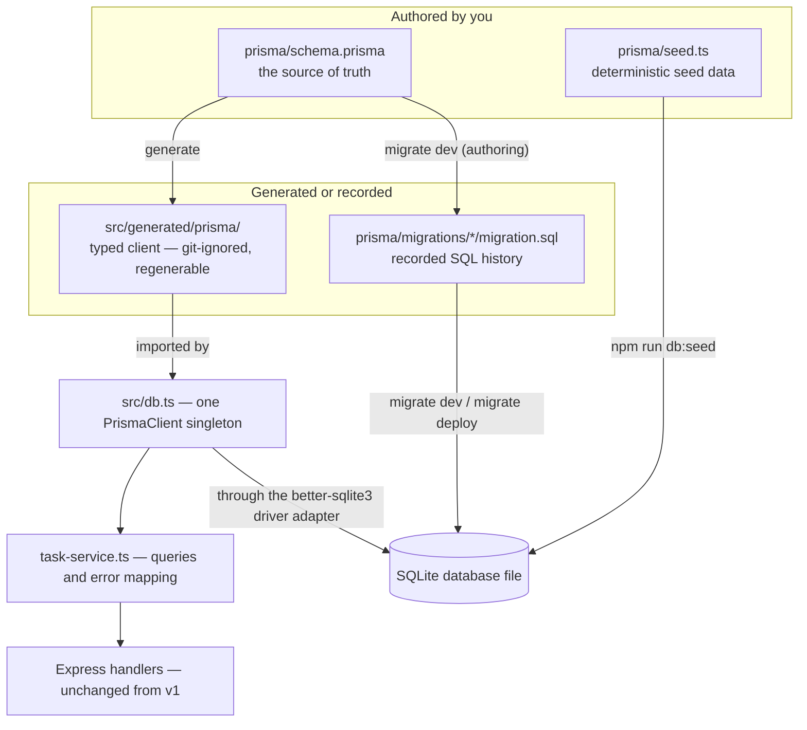

# M07 — Prisma ORM & Migrations

**Week 3 · Days 2–4 · 8 hours**

## 1. From SQL to Prisma

An ORM (Object-Relational Mapper) is a layer that lets you work with database rows as *typed
objects in your programming language* instead of writing SQL strings by hand. In Prisma's case
you describe your tables once in a declarative schema file (`schema.prisma`, its own small
language), and Prisma generates two things from it: **migrations** (SQL files that evolve the
actual database) and a **typed client** (TypeScript code with a method per operation whose
arguments and return values match your schema exactly). A typo in a column name stops being a
runtime surprise and becomes a red squiggle in your editor.

The three pieces always work together in this order:



**The benefits:** type safety end to end (the client knows your models), migrations you can
review like code, one codebase that ports between SQLite/Postgres/MySQL by changing the
datasource and adapter, and relation access (`task.tags`) without hand-writing joins.
**The trade-offs:** an abstraction you must occasionally see through (Prisma generates the SQL
it thinks is best; when it's wrong you need `EXPLAIN QUERY PLAN` and real SQL to argue back),
a code-generation step in your workflow, and features the abstraction doesn't model — SQLite
has no `ENUM` or `CHECK` support in Prisma, and you'll knowingly lose two of M06's constraints
(§3). **Raw SQL stays in the toolkit** (`$queryRaw`, §5) for window functions, CTEs, `EXPLAIN`,
bulk analytic queries — anything the query API can't express or express *well*.

For this module, "the existing Task API" is M05's Express app with its in-memory `store.ts`.
Everything below is about replacing that one file's engine — same routes, same wire contract,
same error envelope — with Prisma on SQLite. Your starting point is
`modules/m05-express-task-api-v1/` in the training-ground repo; the finished module lives at
`modules/m07-prisma-orm-migrations/` and its schema is the M06 relational design
(`modules/m06-sql-fundamentals-sqlite/schema.sql`) translated into Prisma schema language.

## 2. Setting Up Prisma 7 with SQLite

**Install exactly these versions — the program pins Prisma to `^7`.** This is not a style
preference: an unversioned `npx prisma` currently resolves to Prisma 8, whose CLI does not
read `schema.prisma` for this stack and whose SQLite support is still experimental. One-off
commands therefore always carry the version (`npx prisma@7 …`), and `package.json` locks both
packages:

```bash
npm install @prisma/client@^7 @prisma/adapter-better-sqlite3 better-sqlite3
npm install -D prisma@^7 dotenv
```

Three setup traps this program has already hit, so you don't have to:

- **npm's install-script gate blocks silently.** npm refuses to run lifecycle scripts for
  packages you haven't approved: `prisma`, `better-sqlite3` (its native build!), and
  `@prisma/engines` all get skipped with only a warning — "installed" but unusable. After any
  install change, approve and rebuild, then *prove* the bindings load:

  ```bash
  npm install-scripts approve prisma
  npm install-scripts approve better-sqlite3
  npm install-scripts approve @prisma/engines
  npm rebuild better-sqlite3 prisma @prisma/engines
  node -e "const DB=require('better-sqlite3'); new DB(':memory:'); console.log('binding OK')"
  ```

- **Pin `better-sqlite3` inside the adapter's own range.** The driver adapter declares
  `better-sqlite3: ^12.6.0`; an unpinned install grabs v13 and npm then hoists *two* native
  copies (one of them nested, compiled by a toolchain path you never test). Keep the direct
  dependency at `^12.6.0` and confirm a single version with `npm ls better-sqlite3`.
- **On the training harness (fnm, Windows):** fnm's `exec` resolves npm only by its `.cmd`
  name — `fnm exec --using=24 -- npm …` fails with "program not found". Every command in this
  material becomes `fnm exec --using=24 -- npm.cmd …`, `fnm exec --using=24 -- npx.cmd prisma@7 …`.

Initialize Prisma (the `--datasource-provider sqlite` flag pre-fills the SQLite datasource):

```bash
npx prisma@7 init --datasource-provider sqlite
```

It generates `prisma/schema.prisma`, `.env` with `DATABASE_URL="file:./dev.db"`, a
`.gitignore`, and the CLI config file — on Prisma ≥7.10 that file is **`prisma7.config.ts`**
(before 7.10 it was `prisma.config.ts`; check what *your* init generated rather than trusting a
blog post). It also drops AI-assistant scaffolding (`.claude/`, `.windsurf/`, `.agents/`,
`skills-lock.json`) — delete those in a training repo. The config file loads `.env` via
`dotenv/config` (hence the `dotenv` devDependency) and is where schema path, migrations path,
`DATABASE_URL`, and the seed command (§8) live.

**Constructing the client: one instance, explicit adapter.** Prisma 7 clients do not open
databases themselves — a *driver adapter* does the I/O. This module uses the official
`better-sqlite3` adapter, and the whole runtime wiring is one small module, `src/db.ts`:

```ts
import "dotenv/config";
import { PrismaBetterSqlite3 } from "@prisma/adapter-better-sqlite3";
import { PrismaClient } from "./generated/prisma/client.ts";

const url = process.env["DATABASE_URL"] ?? "file:./dev.db";
const adapter = new PrismaBetterSqlite3({ url });

export const prisma = new PrismaClient({ adapter });
```

Watch the casing: the class is `PrismaBetterSqlite3` (lowercase "qlite3") — importing
`PrismaBetterSQLite3` fails at load with a bare "does not provide an export named" error.
Constructing **one** client at module load (not per request, not per function) is the
singleton pattern: each `PrismaClient` owns connection state and prepared-statement caches, so
"one per request" leaks both.

**`prisma generate` is explicit, and it is not optional.** The generated client lands in
`src/generated/prisma/` (your generator block sets `output`; this module also sets
`importFileExtension = "ts"` so generated imports match the project's `.ts` import style).
That directory is **project code that is git-ignored**: it's reproducible from `schema.prisma`
plus the pinned Prisma version, so it's never committed — and therefore must be regenerated
**after install, after every schema change, and in CI**:

```bash
npx prisma@7 generate
```

Skip this and the first fresh clone dies on a missing import with no other symptom. Organizing
rule for the whole module: `prisma/` holds schema, migrations, config, and seed; `src/db.ts`
is the only module that imports the generated client; everything above it talks to
`task-service.ts` (§6), never to the client directly.

> **Practice:** Set up Prisma and verify that the application can connect to SQLite.

1. Run the installs, approvals, and `prisma7.config.ts`/`prisma init` steps above; pin
   `better-sqlite3` to `^12.6.0` and confirm `npm ls better-sqlite3` shows one version.
2. Create `src/db.ts` as shown and generate the client (`npx prisma@7 generate`).
3. Verify the connection — the simplest check that needs no schema yet:

   ```bash
   node --experimental-strip-types -e "import('./src/db.ts').then(async m => { await m.prisma.\$disconnect(); console.log('connected'); })"
   ```

   and/or open the database in a file browser with `npx prisma@7 studio` (§8) and stop it
   again with `Ctrl+C`. A generated `dev.db` file plus "connected" means the whole
   config → env → adapter → client chain works.

## 3. Modeling Your Database with Prisma Schema

`prisma/schema.prisma` is the single source of truth. The vocabulary you need, mapped onto
this module's actual choices:

- **Models and scalar types.** Each `model` block is a table; each field a column. SQLite
  supports `String`, `Int`, `Float`, `Boolean`, `DateTime`, `Json`, `Bytes` — but remember the
  storage lesson from M06: SQLite has ~no real type system, columns are dynamically typed
  cells, and Prisma does the sensible mapping (our `DateTime` columns are ISO-8601 *text*
  underneath — verified round-trip, §5).
- **Keys and defaults.** `@id`, `@default(uuid() | autoincrement() | now() | literal)`,
  `@unique`, `@@unique([...])` for composite uniques, `@@index([...])` for plain indexes.
- **Automatic timestamps.** `@updatedAt` makes Prisma stamp the column on every `update` —
  client-side, replacing M06's explicit "bump `updated_at`" convention (and any trigger you
  might have written). `createdAt` is `@default(now())`.
- **Relations.** A `@relation(fields: [fk], references: [id])` on the "many" side models the
  FK; the "one" side holds the list field. Referential actions (`onDelete: Cascade | Restrict |
  SetNull`) are declared on the FK-owning side and become part of the generated DDL. Many-to-many
  comes in two shapes: *implicit* (both sides hold a list field; Prisma creates and owns an
  invisible join table) and *explicit* (you model the junction table yourself).
- **Naming maps.** `@map("user_id")` / `@@map("tasks")` keep snake_case names in the database
  so your `.schema` output stays diffable against M06's `schema.sql`.

This module's translation decisions, all visible in the shipped schema:

1. **UUID String ids, not `autoincrement`.** M06 used `INTEGER PRIMARY KEY` (a rowid alias) —
   a *storage* choice. But the ids on the wire are M05's frozen *contract*: the Bruno suite
   asserts string ids, `isValidId` gates UUID shape, one test hardcodes a UUID for its 404
   case. When contract and storage disagree, the contract wins: `@id @default(uuid())` on a
   `String`, and the deviation is documented rather than hidden.
2. **Explicit junction model, not implicit M:N.** M06's `task_tags` has a composite PK, an
   index on `tag_id`, and *different* actions per side — delete a task cascades its junction
   rows, delete an in-use tag is refused (`RESTRICT`). Implicit M:N hides the join table and
   flattens that control; the explicit model reproduces `schema.sql` statement for statement:

   ```prisma
   model TaskTag {
     taskId String @map("task_id")
     tagId  String @map("tag_id")

     task Task @relation(fields: [taskId], references: [id], onDelete: Cascade)
     tag  Tag  @relation(fields: [tagId], references: [id], onDelete: Restrict)

     @@id([taskId, tagId])
     @@index([tagId])
     @@map("task_tags")
   }
   ```

3. **Both CHECK constraints are knowingly lost.** Prisma on SQLite cannot express `CHECK`;
   `ck_users_email` and `ck_tasks_status` have no equivalent. The schema header records each
   loss *and names the enforcement point* (status is validated on input by M05's validators —
   M08's Zod takes it over properly). A constraint you know you lost is a trade-off; one you
   forgot you lost is a defect.
4. **The per-owner unique survives verbatim.** M06's `uq_tasks_user_title` becomes
   `@@unique([userId, title])` on `Task` — the database layer of the program-wide rule
   "one title, one task" (API 409 ⊂ this unique ⊂ globally-unique seed data, §6/§8).
5. **The new field, `priority`, is required with NO database default.** "Medium" for new API
   tasks is application policy, and policy belongs in the service layer — the column's only
   job is refusing NULLs. This choice is also exactly what makes the next section's migration
   a hand-edit rather than a one-liner.

The full `Task` model, for reference (users/tags follow the same patterns):

```prisma
model Task {
  id          String    @id @default(uuid())
  userId      String    @map("user_id")
  title       String
  description String    @default("")
  status      String    @default("todo") // CHECK lost: input-validated instead
  priority    String                      // added by migration 2; service decides values
  dueDate     DateTime? @map("due_date")
  createdAt   DateTime  @default(now()) @map("created_at")
  updatedAt   DateTime  @updatedAt @map("updated_at")

  user     User      @relation(fields: [userId], references: [id], onDelete: Cascade)
  taskTags TaskTag[]

  @@unique([userId, title])
  @@index([userId])
  @@map("tasks")
}
```

> **Practice:** Build the Prisma schema for the Task API and generate the corresponding client.

Translate M06's four tables (`users`, `tasks`, `tags`, `task_tags`) using the decisions above;
run `npx prisma@7 generate`; then skim the generated `src/generated/prisma/models/` to see what
your schema produced. Every schema change from here on gets a generate before anything else
compiles.

## 4. Understanding Database Migrations

A migration is a **file of SQL that moves the database from one recorded state to the next**.
Prisma tracks which ones a database has applied in a bookkeeping table, `_prisma_migrations`
(one row per migration: name, checksum, started/finished timestamps). `prisma/migrations/`
grows one timestamped folder per change — `20261021024629_m06_translation/migration.sql` —
plus `migration_lock.toml` (one line: the provider; it stops a Postgres teammate from
"helpfully" re-diffing your SQLite history into another dialect).

**Authoring: `npx prisma@7 migrate dev --name m06_translation`.** This diffs your schema
against the migration folder, writes the missing SQL, applies it to your local `dev.db`, and
records it. Read the generated file — it is real SQL and it teaches the mapping: composite
`PRIMARY KEY ("task_id","tag_id")`, `CONSTRAINT "task_tags_tag_id_fkey" … ON DELETE RESTRICT`,
`CREATE UNIQUE INDEX "tasks_user_id_title_key" ON "tasks"("user_id","title")`. What
`schema.prisma` says, `migration.sql` proves.

**Adding a required column to a table that already contains data** — the module's headline
scenario. We added `priority` to `tasks`. Three possible shapes, decided *before* touching SQL:

1. A constant default is acceptable → `ALTER TABLE … ADD COLUMN … NOT NULL DEFAULT 'medium'`
   is one line and safe on a populated table. (We rejected this: the default is policy.)
2. The value is derived from existing rows → you need a backfill phase.
3. Derived **and** constrained with no default (our case) → closed: SQLite cannot add a
   NOT NULL column without a constant default, and cannot alter a column's constraints at all.
   The only route is a **table rebuild** — create the new shape, copy data across, drop,
   rename, recreate indexes.

Now watch what the tools actually do. First, `migrate dev` refuses out loud:

```text
⚠️ We found changes that cannot be executed:
  • Step 0 Added the required column `priority` to the `tasks` table without a
    default value. There are 4 rows in this table, it is not possible to execute this step.
```

That refusal is information: *the schema diff knows the structure and nothing about your
data.* Second, scaffold without applying, with `--create-only`:

```bash
npx prisma@7 migrate dev --create-only --name add_priority
```

You get the folder, unapplied — your edit point. The generated SQL is Prisma's standard
RedefineTables skeleton (create `new_tasks`, `INSERT … SELECT`, drop, rename, recreate the
indexes), but its `INSERT INTO "new_tasks" (…) SELECT "created_at", … FROM "tasks"` copies
every column *except* `priority` — run it on 4 rows and only the new NOT NULL can stop it.

**Editing before applying is legitimate; editing after applying is forbidden.** The migration
has not been applied, so rewriting this file is safe and intended. Once a migration is
recorded in `_prisma_migrations`, its file must never change — every other database in the
team replays recorded history, and a silent edit forks that history. Applied-and-wrong means
you write a *new* migration that fixes it.

The hand-edit keeps the scaffold and adds exactly one thing a diff could never contain — the
value source:

```sql
INSERT INTO "new_tasks" (…, "priority")
SELECT …,
    CASE
        WHEN "due_date" IS NULL                          THEN 'low'
        WHEN "due_date" < '2026-10-21T00:00:00.000+00:00' THEN 'high'
        ELSE 'medium'
    END
FROM "tasks";
```

Two details carry the craft. The timestamp is a **fixed literal** (the migration's authored
date), not `now` — migrations replay forever and "relative to today" is not deterministic; on
a fresh clone this migration runs over zero rows and the backfill is a no-op (priorities then
come from the seed, §8, using the same rule so both eras of data look identical). And before
the rebuild's `DROP TABLE`, check what points *at* the table: under enabled foreign keys, a
drop performs an implicit `DELETE FROM` that would silently CASCADE `task_tags` away — M06's
silent-FK lesson, one layer up. Our history guarantees the junction is empty at this point
(verified before applying; true on every fresh replay), and the SQL header *states* that
assumption — SQL cannot assert its own preconditions, so comments are.

**Checking and shipping.** `npx prisma@7 migrate status` lists applied/pending per database.
`npx prisma@7 migrate deploy` replays pending recorded migrations in order — no diffing, no
prompting, no generation — which is why it's the only migrate command that belongs near a
production database. `npx prisma@7 migrate reset` is the opposite pole: it **drops the entire
development database** and replays all migrations from scratch (in this program it is chained
with the seed, §8 — and note Prisma 7.10+ requires explicit consent when an agent runs it).
`npx prisma@7 db push` makes the database match the schema with **no history at all** — fine
for prototyping, useless for anything you'll need to replay. Migration *conflicts* in a team
PR are the same shape as code conflicts: two branches each added a migration, both timestamped
"first" — the file content doesn't conflict, the ordering does; resolve by rebasing, re-running
`migrate dev` so one fresh migration replaces both, and re-applying from a reset.

| Command | What it does | Where it belongs |
|---|---|---|
| `migrate dev` | diff → generate → apply; prompts; resets | your development machine |
| `migrate deploy` | replay recorded history, nothing else | CI / production |
| `migrate reset` | drop database → replay all → (seed) | development only |
| `db push` | schema → database, no history | throwaway prototyping |

> **Practice:** Create the initial database migration, introduce a new Task field in a second migration, and deliberately edit one migration before applying it.

1. `npx prisma@7 migrate dev --name init` for the translated M06 schema; read the SQL.
2. Add `priority String` (required, no default) to `Task`; scaffold with `--create-only`; try
   `migrate dev` once on a populated table to *see* the refusal, then read the scaffold's SQL.
3. Hand-edit the `INSERT … SELECT` with the `CASE` backfill above; apply; verify the data
   (`SELECT title, due_date, priority FROM tasks ORDER BY priority`) and the final DDL
   (`npx prisma@7 db execute` or Prisma Studio), plus `PRAGMA foreign_key_check`.

## 5. Querying Data with Prisma Client

The generated client gives you a typed method per operation. The CRUD core (all async):

```ts
const created = await prisma.task.create({ data: { userId, title: "Buy milk", priority: "medium" } });
const one     = await prisma.task.findUnique({ where: { id } });           // null if missing
const many    = await prisma.task.findMany({ where: { status: "todo" } }); // [] if none
const updated = await prisma.task.update({ where: { id }, data: { title: "Buy oat milk" } });
const gone    = await prisma.task.delete({ where: { id } });               // throws if missing
const upserted = await prisma.task.upsert({
  where:  { userId_title: { userId, title } },   // the @@unique([userId, title]) as a compound where
  create: { userId, title, priority: "medium" },
  update: { description: "now with description" },
});
await prisma.task.createMany({ data: rows });     // bulk insert, no returned rows
```

**Filtering** composes in the `where` object — every condition on a row is a key, and logical
combinators are keys too:

```ts
await prisma.task.findMany({
  where: {
    status: { in: ["todo", "in_progress"] },
    OR:     [{ title: { contains: "milk" } }, { description: { contains: "milk" } }],
    NOT:    { priority: "low" },
    dueDate: { gte: new Date("2026-10-01T00:00:00.000Z") },
    userId:  { equals: someId },                 // plain values shorthand for { equals }
  },
});
```

`contains`, `startsWith`, `equals`, `in`, `gte`/`lte`, `AND`/`OR`/`NOT` — values inside these
objects are always **parameterized** by the engine; that's your injection safety (M06's demo,
one layer up). **Sorting and pagination** are `orderBy` + `skip`/`take`:

```ts
await prisma.task.findMany({
  orderBy: [{ createdAt: "desc" }, { id: "asc" }],  // id tiebreak = deterministic pages
  skip: (page - 1) * pageSize,
  take: pageSize,
});
```

The secondary `id` sort is not decoration: timestamps collide, and unstable order makes page 2
silently repeat or skip rows.

**`select` vs `include`** decides the shape and the cost. `include` adds *relations* on top of
all scalar fields; `select` picks an exact field set (including relation fields), and the
return type follows it precisely:

```ts
const titles = await prisma.task.findMany({ select: { id: true, title: true } });
// rows: { id: string; title: string }[] — nothing else, enforced by the type

const withTags = await prisma.task.findUnique({
  where: { id }, include: { taskTags: { include: { tag: true } } },
});
```

**Nested writes** create related rows in one round trip (and one transaction under the hood):
`prisma.task.create({ data: { …, taskTags: { create: [{ tag: { create: { name: "home" } } }] } } })`
— create the task, its tag, and the junction row together. **Aggregation** lives on the same
client: `prisma.task.count({ where })`, and `prisma.task.groupBy({ by: ["status"], _count: true, _avg: … })`.
**Transactions** come in two forms — a *batch* of already-built queries (executed as one
transaction, results returned as a tuple) and an *interactive* callback for logic between
writes:

```ts
const [rows, total] = await prisma.$transaction([
  prisma.task.findMany({ where, orderBy, skip, take }),
  prisma.task.count({ where }),
]);   // this is exactly how the list endpoint gets data + total consistently (§6)

await prisma.$transaction(async (tx) => {
  await tx.task.update({ where: { id }, data: { status: "done" } });
  await tx.audit.create({ data: { taskId: id, action: "done" } });
});
```

**When the query API is not enough**, `$queryRaw` uses a tagged template to parameterize for
you — raw SQL, never string concatenation:

```ts
await prisma.$queryRaw`SELECT status, COUNT(*) FROM tasks GROUP BY status`;
```

And when something looks wrong, **turn on query logging** (`new
PrismaClient({ adapter, log: ["query"] })` or `log: [{ level: "query", emit: "event" }]`) and
read the exact SQL the engine sent — the fastest way to convert "Prisma is slow" into a
missing index or an N+1.

> **Practice:** Write queries for common Task API operations, then implement filtering, sorting, and pagination for the task listing endpoint.

Reproduce each snippet against the seeded database (§8) in a scratch script (`npx prisma@7
studio` browses the same data interactively). Then build the list query the service will use:
`where` from `status`/`q`, `orderBy` with the `id` tiebreak, `skip`/`take` from `page`/`pageSize`,
and `data` + `count` inside one batch `$transaction` — but return `{ data, meta }` (§6).

## 6. Building a Database Service Layer

M05 already drew the line you now reuse: handlers say *what* (HTTP), the store said *how*
(data). M07 swaps the engine behind that line. `src/services/task-service.ts` replaces
`store.ts` wholesale — same callers, same wire contract — and is the **only** module that
talks to the client:

- **The singleton stays put.** The service receives the one `PrismaClient` from `src/db.ts`
  (dependency injection by constructor) — it never constructs its own, and no handler imports
  `db.ts`. That seam is what M09's tests will mount against a test database.
- **CRUD maps one-to-one**, with the service converting database rows to wire objects (`toWire`):
  `Date` → ISO string or `null`, empty `description` omitted, `status`/`priority` narrowed to
  their union types.
- **Filters, sorting, pagination** (from §5) assemble a `where` object, whitelist the sort
  fields (`title | createdAt | dueDate` — deliberately not `priority`, whose lexicographic
  order in SQLite would lie: `'high' < 'low' < 'medium'`), and validate `page`/`pageSize`
  bounds in the handler (repeated query params like `?status=a&status=b` parse to an array and
  are rejected — silently dropping them would answer the request *unfiltered*, a 200 that lies).
- **The `{ data, meta }` envelope** is fetched as `data` + `total` in one batch `$transaction`,
  so the count can never disagree with the rows:

  ```json
  { "data": [ { "id": "…", "title": "Plan sprint retro", "status": "todo",
                "priority": "medium", "dueDate": "2026-10-23T00:00:00.000Z" } ],
    "meta": { "page": 2, "pageSize": 5, "total": 18, "totalPages": 4 } }
  ```

- **One pinned owner makes the uniqueness rule line up.** The M05 API is userless (its contract
  has no `userId`), but `tasks.user_id` is NOT NULL. The service pins every API write to
  `DEFAULT_OWNER_ID` — a fixed constant that `prisma/seed.ts` *imports and creates* (§8).
  Because the API's whole world is that one owner, the DB's per-owner unique enforces exactly
  M05's global "one title, one task" 409 — and seed data stays globally unique so it never
  contradicts either layer.
- **Behavior preservation is part of the contract, error precedence included.** M05's update
  checked duplicate titles *before* existence — so `PATCH <missing-uuid> {"title": "Buy milk"}`
  answered **409**, not 404. A naive Prisma `update` inverts that (P2025 fires first), and no
  Bruno test asserts the case. The service restores the old ordering with an explicit
  pre-check; the lesson generalizes: when you swap a layer, diff the old implementation's
  *behavior* — not just its tests — and classify every difference as **restore or document**.
  (The one documented difference: v1 echoed an explicitly-supplied `""` description; v2
  renders `""` as absent, because M06's `NOT NULL DEFAULT ''` column cannot distinguish
  "cleared" from "never set". Same stored value, one fewer wire shape.)

Why this layer earns its keep: handlers shrink to validation plus a service call (no
`try/catch` in the handlers — Express 5 forwards rejected promises to the central error
handler, and §7's mapping happens in the service's single catch block per operation), every
query policy (owner pin, sort whitelist, page cap, wire mapping) lives in one reviewable file,
and M08 (Zod) and M09 (Supertest against
a test database) each replace *one* file without touching the others.

> **Practice:** Upgrade the existing Task API to use Prisma while preserving its established API behavior.

Fork the M05 module, build the service, rewire `app.ts`/`routes/`. Then run M05's Bruno
collection **byte-unmodified** against the v2 server (§10 step 6) — 15/15 green is the floor;
then probe the corners tests don't cover: `PATCH` a missing UUID with a taken title (must be
409) and with a fresh title (must be 404), `GET /tasks` with no params (now capped at 20 with
`meta` — a documented change, not an accident).

## 7. Type-Safe Queries and Database Error Handling

The client is generated *from your schema*, so its types are not approximations:

```ts
import { Prisma, type Task } from "./generated/prisma/client.ts";

// input / payload types live under the Prisma namespace:
const data: Prisma.TaskCreateInput = { userId, title: "Write sprint report", priority: "medium" };
const where: Prisma.TaskWhereInput = { status: { in: ["todo", "in_progress"] }, NOT: { priority: "low" } };

// Return types follow select/include exactly:
const picked = await prisma.task.findMany({ select: { id: true, title: true } });
//    ^? Array<{ id: string; title: string }>
const full = await prisma.task.findUnique({ where: { id }, include: { taskTags: true } });
//    ^? (Task & { taskTags: TaskTag[] }) | null

// satisfies keeps an object checked against a Prisma shape without widening it:
const taskSelect = { id: true, title: true } satisfies Prisma.TaskSelect;
```

`Prisma.TaskCreateInput` (what `create` accepts), `Prisma.TaskWhereInput` (what `where`
accepts), `Prisma.TaskGetPayload<{ include: … }>` (the type a payload resolves to) — rename a
field in `schema.prisma` and every use lights up before anything runs. That is the entire
"typed queries" story: the schema is the type source, and drift is a compile error.

**The three error codes you must know.** A `create` with a taken unique value, an `update` to
a record that vanished, a row referencing a missing parent — Prisma throws
`PrismaClientKnownRequestError` with a stable `code`:

| Code | Meaning | Mapped to | HTTP |
|---|---|---|---|
| `P2002` | unique constraint violation | `ConflictError` | 409 |
| `P2025` | record not found (update/delete/upsert) | `NotFoundError` | 404 |
| `P2003` | foreign key violation | `BadRequestError` | 400 |

P2003 maps to 400 rather than 409 on purpose: a dangling reference means the caller sent (or
the service computed) a reference that never existed — a bad request, not a state clash.

**Extend the existing handler; do not build a new one.** M05's `AppError` hierarchy, central
`error-handler.ts`, and the `{ error: { code, message, details?, requestId } }` envelope stay
untouched — the translation happens once, at the service seam:

```ts
export function mapPrismaError(err: unknown, context: { title?: string; id?: string } = {}): unknown {
  if (err instanceof Prisma.PrismaClientKnownRequestError) {
    switch (err.code) {
      case "P2002": return new ConflictError(`A task with title "${context.title}" already exists`);
      case "P2025": return new NotFoundError(`Task ${context.id} not found`);
      case "P2003": return new BadRequestError("Referenced resource does not exist");
    }
  }
  return err;   // NOT ours — stays a programmer error, surfaces as 500 with nothing leaked
}
```

Every service method wraps its call and rethrows `mapPrismaError(err, context)`; handlers keep
throwing plain `AppError`s; the untouched central handler renders whichever it receives. Note
the last line: anything that isn't a known Prisma code passes through **unchanged** — the
mapping widens the operational-error set, it does not swallow bugs. And note what the wire
messages preserve: M05's exact duplicate-title wording, so `03-create-duplicate-409` passes
byte-unmodified.

One honesty rule for codes you can't reach: the tasks-only API pins a valid owner id, so P2003
is *unreachable through HTTP* — its mapping is proven by a direct-client script
(`npm run prove:errors` forces all three codes through the real client and the same
`mapPrismaError`), not by claiming it. Prove-at-the-seam beats assert-in-prose.

> **Practice:** Handle database errors consistently and verify the expected HTTP status codes.

With the server running (`npm run dev`) and the database seeded:

```bash
# duplicate seeded title  -> 409 CONFLICT envelope (P2002)
curl -s -X POST http://localhost:3000/api/v1/tasks -H "Content-Type: application/json" -d '{"title":"Buy milk"}'
# well-formed missing id  -> 404 NOT_FOUND (P2025)
curl -s -X DELETE http://localhost:3000/api/v1/tasks/00000000-0000-4000-8000-00000000ffff
# malformed id / bad body -> 400 VALIDATION_ERROR with details[] (M05 validators, untouched)
curl -s http://localhost:3000/api/v1/tasks/not-a-uuid
```

Then run `npm run prove:errors` for the seam-level proof of all three codes including the
unreachable P2003, and confirm in the diff that `error-handler.ts`/`errors.ts` never changed.

## 8. Seeding and Inspecting Database Data

Seeding is the practice of loading a database with **deterministic, purpose-shaped** rows, and
repeatable seed data is what makes everything else in this module verifiable — migrations with
backfills, pagination tests, Bruno assertions, and your own debugging all need *the same*
rows after every rebuild. The design rules this module's seed follows (and M06 established):

- **Fixed ids, not random ones.** Every row's UUID is a readable constant
  (`00000000-0000-4000-8000-…`), so evidence transcripts, Bruno requests, and code constants
  (the service's `DEFAULT_OWNER_ID` — the seed *imports that constant* and creates its first
  user from it) all agree after every reset. Random ids make all four impossible.
- **Shape data for the questions you'll ask.** At M06 parity: 4 users / 18 tasks / 7 tags /
  30 junction rows, with the deliberate empties preserved — Dave with zero tasks, tasks 11 and
  16 untagged, tag `someday` unused, due dates mixing NULL and past/future values (which is
  what gives the §4 backfill rule all three outputs: low/medium/high).
- **Parents before children** — users → tasks → tags → task_tags — or the FKs refuse the
  insert (M06's insert-order lesson, unchanged).
- **The seed grades itself.** After inserting, it counts every table and invariant and prints
  `SEED PASS` or exits non-zero — an executable spec, so a silently-drifted seed fails loudly:

  ```text
  seed counts: { users: 4, tasks: 18, tags: 7, pairs: 30, untagged: 2, unusedTag: 1 }
  SEED PASS — default owner: Alice Nguyen <alice@example.com>
  ```

(No credentials are copied into this material — hashes and passwords live only in
`prisma/seed.ts`, which is data-shaping code, not a place to paste values from.)

**Migrations and the seed work as a pair.** Migrations build *structure* from empty tables —
on a fresh clone the §4 backfill touches zero rows; the seed supplies the *values*, using the
same derivation rule so migrated-era and seeded-era data are indistinguishable. In this
program the pair ships as one command, wired in `package.json`:

```json
"db:seed":   "tsx prisma/seed.ts",
"db:reset":  "prisma migrate reset --force && tsx prisma/seed.ts",
```

The chain matters on Prisma 7.10+: `migrate reset` no longer runs the configured
`migrations.seed` (from `prisma7.config.ts`) by itself — `npx prisma@7 db seed` does — so
`db:reset` = drop → replay migrations → seed, every time, identically. Two notes for the road:
`migrate reset` **destroys a database**, which is fine precisely because `dev.db` is a
gitignored local artifact that exists to be rebuilt — never point it at anything shared — and
Prisma 7.10+ asks an agent for explicit consent before running it (humans get a normal prompt;
automation needs the consent environment variable). **Inspecting** the result is Prisma
Studio: `npx prisma@7 studio` opens a local web UI over `users`/`tasks`/`tags`/`task_tags`
with relations clickable — close it with `Ctrl+C`.

> **Practice:** Reset the database, apply the migrations, seed it, and inspect the resulting records.

```bash
npm run db:reset     # drop + replay both migrations + seed; expect the SEED PASS block
npm run db:seed      # re-run standalone: safe (children cleared first), same counts
npx prisma@7 studio  # browse tasks: priority/dueDate filled, junction rows on tasks 1-10 etc.
npx prisma@7 migrate status   # both migrations applied, none pending
```

Run `db:reset` twice — identical counts both times is the DoD, not a nicety.

## 9. Beyond SQLite: Other Databases and Prisma Versions

*Concept only — no hands-on in this module; this section is what you carry to the next stack.*

**PostgreSQL** is the same schema, four changes of substance. The `datasource` provider becomes
`postgresql` (and the migration lock then pins *that* — history is provider-locked); the driver
adapter becomes `@prisma/adapter-pg` with a `postgres://` URL (the client wiring in `db.ts`
is the only code that changes); real types appear (`@db.Text`, `enum`s, `Json`, `citext`),
which is where the two lost M06 CHECKs could finally come back; and **connection pooling stops
being free** — SQLite is a file with no server, Postgres connections are expensive, so
production setups put PgBouncer or the adapter's pool between the client and the database,
and a "one client per process" rule now also means "one *pool* per process."

**MongoDB** changes the question, not just the answers. The document model stores nested
objects whole — a task could embed its tags array in one document, reads are join-free by
construction — and there are no foreign keys: `P2003` has no meaning, and "referential
integrity" becomes application-level discipline. But relations you *do* model cost
dollar-priced `$lookup`s, there are no transactions across collections in the free-tier mental
model, and the schema is a suggestion the database will not enforce. Prisma's MongoDB support
exists, and the trade is the classic document one: shape and read-speed for integrity and
ad-hoc joins.

**Prisma 8** exists and is why this program pins `^7` mechanically: an unversioned
`npx prisma` resolves to 8, whose CLI does not read `schema.prisma` for this stack and whose
SQLite support is still experimental. The client API is recognisable, but treat any major
version as a migration project of its own — read its changelog before upgrading, and until
this program moves, let `package.json`'s `^7` and `npx prisma@7` make the choice for you.

## 10. Putting It All Together: Task API v2

The full checkpoint sequence, in order. Working directory:
`modules/m07-prisma-orm-migrations/` in the training-ground repo; Node 24 via the fnm wrap
where the harness needs it.

- Review the Prisma schema and migration history.
  Read `prisma/schema.prisma` end to end — every M06 constraint is either mapped (unique,
  indexes, FK actions, junction PK) or named as a loss (both CHECKs). Then
  `npx prisma@7 migrate status` (both migrations applied, none pending, no drift) and read
  both `migration.sql` files: `20261021024629_m06_translation` should be recognisable as
  M06's DDL, and `20261021025428_add_priority` should show the `CASE` backfill inside the
  RedefineTables rebuild — with its header comment stating the authored-date cutoff and the
  empty-junction assumption.
- Verify that the service layer uses persistent storage.
  Confirm no file under `src/routes/` imports `db.ts` or mentions Prisma — handlers call
  `task-service.ts` only — and that `src/store.ts` no longer exists. Restart the server
  (`npm run dev`), create a task, restart again, `GET` it back: persistence, not process
  memory. `npm run db:smoke` additionally proves the DateTime round-trip, defaults,
  `@updatedAt`, and CASCADE (4/4).
- Exercise the list endpoint's filters, sorting, and pagination.
  `GET /api/v1/tasks?status=todo`, `?q=milk` (title *or* description contains),
  `?sort=title&order=asc`, `?page=2&pageSize=5` — check `meta` reports the filtered total
  (`{ page: 2, pageSize: 5, total: 18, totalPages: 4 }` on seeded data), that page order is
  deterministic (the `id` tiebreak), and that garbage params (`?status=nonsense`,
  `?page=0`, repeated `?status=a&status=b`) all answer 400 with per-field `details`.
- Verify that database errors map to the expected HTTP responses.
  The four curls from §7 (409 duplicate, 404 missing, 400 malformed id, 400 bad body), plus
  `npm run prove:errors` for the seam-level P2002/P2025/P2003 proof — and in the same session,
  the precedence corner: `PATCH` a missing UUID with a taken title (409) versus a fresh title
  (404). The envelope must be M05's, rendered by the untouched handler.
- Rebuild and seed the database from scratch.
  `npm run db:reset` — twice. Both runs end in the identical graded block
  (`users: 4, tasks: 18, tags: 7, pairs: 30, untagged: 2, unusedTag: 1` + `SEED PASS`), and
  `PRAGMA foreign_key_check` (via Prisma Studio's tables or a `db execute`) is clean. This is
  the module's hardest DoD: structure *and* data from zero, every time.
- Run the existing Bruno API collection against Task API v2 and investigate any regressions.
  With the server up on `:3000` against the freshly seeded database:

  ```bash
  cd bruno && bru run --env local
  ```

  Expect **23/23 requests, 30/30 tests, 21/21 assertions**: M05's 15 (byte-unmodified — they
  are the contract) plus the 8 `v2/` proofs (filters, sort, pagination meta, priority/dueDate
  wire fields, seeded-title duplicate → 409, invalid query → 400). Any failure is a
  regression to investigate, not a test to edit — the v1 requests change only when the
  contract changes, and this module's whole point is that it didn't.
