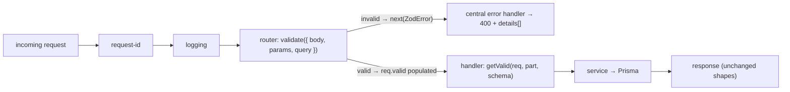

# M08 — Zod Validation & Type Inference

**Week 3 · Days 4–5 · 6 hours**

## 1. Introduction to Runtime Validation

**Why TypeScript types disappear at runtime.** TypeScript is a *development-time* tool: `tsc`
checks your annotations and then erases them. The JavaScript that actually runs — your server,
the code Express calls when a request arrives — contains no types at all. Ask the running
process what type `req.body.title` is and the honest answer is "whatever the client sent":
`42`, `null`, `["x"]`, or nothing at all. Types protect the *author* of the code; they say
nothing about its *input*.

**Why `req.body`, route parameters, and query strings are untrusted input.** Everything that
crosses the network is attacker-controlled until proven otherwise. `GET /api/v1/tasks?page=0`
arrives as text; `POST /api/v1/tasks` delivers whatever JSON the sender composed — including
fields your API never declared, wrong types for fields it did, and strings a database should
never see. Validation is the act of *proving* input matches a contract before any code that
trusts that contract runs.

**Compile-time type checking vs runtime validation.** They answer different questions at
different moments:

| | TypeScript (`tsc`) | Runtime validation (Zod) |
|---|---|---|
| When | Before the server starts | On every request |
| Checks | Your code against *your* annotations | Actual data against a schema |
| Input origin | Trusted (you wrote it) | Untrusted (a client sent it) |
| Failure | Red squiggle, build error | 400 response with field-level details |

They are complementary, not competing: types make your code coherent, schemas make your
*input* provable.

**Introducing Zod 4 and its role in the Task API.** Zod is a library for writing **schemas —
validation rules that are simultaneously runtime checks and TypeScript types**. One schema
declares "title is a trimmed non-empty string, status is one of three values", and from that
single declaration you get the check that rejects bad requests *and* the type your handler
receives. In Task API v3, Zod owns every request boundary: bodies, query strings, route params,
and the environment.

**How M08 builds on the Prisma-backed API from M07.** M07 gave Task API v2 a typed service
layer over Prisma — but its request validation was the hand-written code M05 deliberately left
in place (`validateCreateTask`, `validateUpdateTask`, `validateListQuery`, `isValidId`: ~170
lines of `if` statements). Every one of those checks *reimplements* a type by hand at runtime.
M08 replaces that file, not augments it.

**The Task API v3 deliverable and why hand-written validation must be replaced.** The deliverable
is four Zod schemas (create / update / list query / route params), a typed `validate` middleware,
fail-fast environment validation, and handler types *proven* to come from `z.infer`. The stack
constraint is explicit: if the old checks remain "just in case", you now have **two contracts**
— and the day they disagree, you won't know which one answered the request. The old file is
deleted in the same commit that wires the schemas in.

> **Checkpoint:** Explain why TypeScript types alone cannot validate an incoming HTTP request.

## 2. Getting Started with Zod 4 Schemas

**Installing Zod 4 and importing `z`.** The Task API modules pin Node ≥24 (check `.nvmrc`;
on a fresh shell: `eval "$(fnm env --shell bash)" && fnm use 24`). Then:

```bash
npm view zod dist-tags   # confirm: latest → 4.x
npm i zod@4
```

Every file in the module starts the same way:

```ts
import { z } from "zod";
```

**Primitives.** The basic building blocks each validate one shape of value:

```ts
z.string()
z.number()
z.boolean()
z.bigint()
z.null()
z.undefined()
z.unknown()      // accepts anything — useful as the LEFT side of a pipeline
z.any()          // accepts anything and opts out of excess checks
```

**Top-level string formats.** Zod 4 promotes formats to their own functions — `z.string().email()`
is the old spelling; the new one validates in one call and reads better in error output:

```ts
z.email()   // "alice@example.com" ✓, "alice@" ✗
z.uuid()    // "00000000-0000-4000-8000-000000000001" ✓, "not-a-uuid" ✗
z.url()     // "https://example.com" ✓, "example" ✗
```

In this module, `idParamsSchema` is `z.object({ id: z.uuid({ error: "Must be a UUID" }) })` —
it replaced a hand-written `/^[0-9a-f]{8}-…$/i` regex, and (probe-verified) it accepts the seed
UUIDs *and* the all-zero NIL UUID exactly as the regex did.

**`z.object()` vs `z.strictObject()`.** The difference is what happens to keys you didn't
declare:

```ts
z.object({ title: z.string() }).parse({ title: "milk", junk: 1 })
// → { title: "milk" }        ← junk is STRIPPED, silently

z.strictObject({ title: z.string() }).safeParse({ title: "milk", junk: 1 })
// → success: false           ← issue code "unrecognized_keys", keys: ["junk"]
```

Both behaviors are *correct choices* — for different endpoints. Task API v3 uses non-strict for
create (v1 never rejected unknown fields) and strict for PATCH (v2 did). Choosing which is a
contract decision, not a style preference.

**Arrays, enums, literals, unions, and discriminated unions:**

```ts
z.array(z.string())                              // ["a", "b"] ✓
z.enum(["todo", "in_progress", "done"])          // closed string set, autocomplete included
z.literal("v3")                                  // only this exact value
z.union([z.string(), z.number()])                // A or B (tries both)
z.discriminatedUnion("kind", [                   // A or B, selected by a literal field
  z.object({ kind: z.literal("text"), body: z.string() }),
  z.object({ kind: z.literal("image"), url: z.url() }),
])
```

`z.enum` deserves special attention: its values are a *tuple type*, so `z.infer` gives you a
precise union (`"todo" | "in_progress" | "done"`), and the error message can name every allowed
value — which is exactly how the frozen Bruno message
(`Must be one of: todo, in_progress, done`) gets produced.

**Optional, nullable, and default** — three easily-confused modifiers:

```ts
z.string().optional()   // value may be MISSING (undefined) — output: string | undefined
z.string().nullable()   // value may be explicitly null       — output: string | null
z.string().default("x") // value may be MISSING; it is then FILLED IN with "x"
```

`.default()` is the one that bites: it makes the *output* type required (the value is always
present after parsing) while the *input* type allows absence. §5 returns to this.

**Coercing query-string and route-parameter values with `z.coerce.number()`.** Everything in a
URL is a string. Coercion turns `"2"` into `2` *inside the schema*, so the type after
`safeParse` matches what your code always assumed:

```ts
z.coerce.number()            // "2" → 2
z.coerce.number().min(1).max(100)   // then range-check the NUMBER, not the string
```

Task API v3 wraps it with a custom message so every failure mode of `page` reports one frozen
string: `z.coerce.number({ error: "Must be a positive integer" }).int({ … }).min(1, { … })` —
`"abc"`, `"0"`, `"1.5"`, and `"99999999999999999999"` all produce
`Must be a positive integer` (see `evidence/m08/schema-sanity.txt`).

**Schemas describe the shape and rules of acceptable data.** That is the mental shift of this
module: stop thinking "I validated the input" as something you *do* in statements, and start
thinking of validation as a **declarative description you can ask** — `schema.safeParse(x)` —
which you can reuse, compose, derive types from, and test in isolation.

**Try it:** create `scratch.ts` and run it with `npx tsx scratch.ts`:

```ts
import { z } from "zod";

const taskStatus = z.enum(["todo", "in_progress", "done"]);
const port = z.coerce.number().int().min(1).max(65535);

console.log(taskStatus.safeParse("todo"));            // success
console.log(taskStatus.safeParse("nope"));            // failure, one issue
console.log(port.safeParse("3000"));                  // success: data 3000 (number!)
console.log(z.uuid().safeParse("00000000-0000-4000-8000-000000000000")); // success (NIL ok)
```

> **Checkpoint:** Write and test schemas that accept valid values and reject invalid values.

## 3. Parsing Data and Handling Validation Errors

**`parse()` and `safeParse()`.** Both run the same schema; they differ in how failure surfaces:

```ts
schema.parse(x)       // invalid → THROWS a ZodError
schema.safeParse(x)   // invalid → returns { success: false, error: ZodError }
                      // valid   → returns { success: true, data }
```

**Handling successful parsing and failed validation.** `safeParse` returns a *discriminated
union*, so narrowing is one `if`:

```ts
const result = taskStatus.safeParse(input);
if (!result.success) {
  // result.error: ZodError — not thrown, not swallowed
} else {
  result.data; // typed as "todo" | "in_progress" | "done"
}
```

Which to use where: `safeParse` at every untrusted edge (a request is *expected* to fail — that
is not an exception, it's a 400). `parse` inside code whose inputs you already proved valid
(scripts, config after validation) where a throw *should* stop the process.

**Zod issues and their paths.** A failure carries **issues**, one per rule broken:

```ts
const r = createTaskSchema.safeParse({ title: 42, status: "nope" });
r.success === false;
r.error.issues.forEach((issue) => {
  issue.code;    // "invalid_type" | "too_small" | "invalid_value" | "unrecognized_keys" | …
  issue.path;    // PropertyKey[] — e.g. ["title"]  (per-field), [] = whole object/body
  issue.message; // the (possibly custom) sentence
});
```

`path` is what maps to the envelope's `details[].path`; `[]` joins to `""` — which is precisely
where M05 said whole-object errors live ("Body must be a JSON object", "At least one of …").

**Formatting errors with `z.flattenError()`, `z.treeifyError()`, `z.prettifyError()`.** Three
shapes for three audiences (all top-level in Zod 4):

```ts
z.flattenError(err);  // { formErrors: string[], fieldErrors: { title: string[], … } }
z.treeifyError(err);  // nested tree keyed by field — good for rendering forms
z.prettifyError(err); // multi-line human text for a terminal:
// ✖ PORT must be an integer between 1 and 65535
//   → at PORT
```

This module uses `prettifyError` at startup (env failures print readable and exit) and uses
**none of them on the request path** — there the mapping is ours (§8), because the envelope's
`details[]` shape was fixed in M05.

**Customizing messages through the unified `error` parameter.** Zod 4 has one customization
knob, passed as `error` on any schema or check:

```ts
z.string({ error: "Required, non-empty string" })          // base-type message
  .trim()
  .min(1, { error: "Required, non-empty string" })         // per-check message
z.enum(STATUSES, { error: `Must be one of: ${STATUSES.join(", ")}` });
z.unknown().refine((v) => !Array.isArray(v), { error: "Must not be repeated" });
```

> ⚠️ **Version-specific gotcha (Zod 4.6.7, verified):** the *string* form above and the legacy
> `{ message: "…" }` work everywhere; the object form `{ error: { message: "…" } }` **crashes**
> on `.refine()` when the error is read (`iss.inst?._zod.def?.error is not a function`). Use
> the string form. Capture: `evidence/m08/zod4-api-check.txt`.

**Multiple validation issues collected in one response.** `safeParse` does **not** stop at the
first problem — every broken rule in the schema produces an issue in *one* failure. That is
what makes this real request possible:

```
GET /api/v1/tasks?status=nonsense&sort=password&page=0
→ 400, details: [ {path:"status",…}, {path:"sort",…}, {path:"page",…} ]
```

Three problems, one round trip, one detail per field — the client fixes everything at once
instead of playing whack-a-mole. (Bruno request `v2/08` asserts exactly this.)

**Choosing an error-handling approach.** For *request* validation: `safeParse` in middleware,
forward the `ZodError`, let the central handler map it (§6–§8) — never `try/catch` around
`parse` per route, never leak Zod's raw JSON to clients. For *debugging/startup*: `prettifyError`
to the console, because there the audience is you, not an API consumer.

**Try it:** make a failing parse and inspect all three formatters:

```ts
const r = z.object({ title: z.string().min(1) }).safeParse({ title: "" });
if (!r.success) {
  console.log(r.error.issues);            // raw issues (what §8 maps)
  console.log(z.flattenError(r.error));   // { formErrors: [], fieldErrors: { title: […] } }
  console.log(z.prettifyError(r.error));  // terminal-friendly
}
```

> **Checkpoint:** Validate sample input, handle a failed parse, and inspect useful field-level error information.

## 4. Refinements, Transforms, and Schema Composition

**Custom validation rules with `.refine()`.** When a rule doesn't fit a built-in check, `.refine`
takes a predicate and a message:

```ts
z.string().refine((s) => !s.endsWith(" "), { error: "Must not end with a space" });
```

The failure becomes an ordinary issue with its own `path` and `message` — collected alongside
schema issues, mapped like any other (§8).

**Cross-field rules.** `.refine()` also runs on *objects*, where it can see several fields at
once. The Task API's "empty patch" rule is exactly this — with one Zod 4 trap: an object
`.refine()` **still runs when the object parse failed**, so on `PATCH {"foo":1}` the strict
body's unknown-key issue *and* the refine's issue would both land in `details[]`, where m07
returned only the unknown-key one (its emptiness check sat behind an `errors.length > 0`
early return). Keep the cross-field rule, but move it **before** the parse:

```ts
export const updateTaskSchema = z
  .unknown()
  .refine((body) => (isPlainObject(body) ? Object.keys(body).length > 0 : true), {
    error: "At least one of title, description, status is required",
  })
  .pipe(z.object(taskFields(…), { error: … }).partial().strict());
```

`PATCH {}` → guard fails, the pipe stops → one issue at `path: []` → envelope detail
`{ path: "", message: "At least one of …" }`. `PATCH {"foo":1}` → guard passes → only the
strict body's issues. The two error classes stay **mutually exclusive** — byte-identical to
m07 on both shapes. (The predicate skips non-objects, so a non-object body still falls
through to `"Body must be a JSON object"` instead of being misread as an empty patch.)

**Trimming and normalizing incoming strings.** Zod 4 applies string checks **in order**:

```ts
z.string({ error: "Required, non-empty string" }).trim().min(1, { error: "…" })
```

`"   "` → trim → `""` → `min(1)` fails with the *custom* message (verified: the check order
matters — `.trim()` before `.min(1)` is what makes blank-after-trim fail; a `"  milk  "` input
parses to `"milk"`). Normalization lives in the schema, so handlers never see untrimmed text.

**Transforming parsed data with `.transform()`.** A transform changes the *output* after
validation — it's why `z.input` and `z.output` can differ (§5). The environment schema ends
with one:

```ts
export const envSchema = z.object({
  PORT: z.coerce.number({ … }).int({ … }).min(1, { … }).max(65535, { … }).default(3000),
  NODE_ENV: z.enum(["development", "production", "test"], { … }).optional(),
}).transform((env) => ({ port: env.PORT, isProduction: env.NODE_ENV === "production" }));
// z.output<typeof envSchema> = { port: number; isProduction: boolean }
```

The app never touches `process.env.PORT` again — it receives a *shaped config object* whose
type is derived from the very schema that validated it.

**Pipes and how parsing stages compose.** `.pipe()` feeds one schema's output into the next;
`z.preprocess(fn, schema)` runs a function *before* a schema. Task API v3's query fields compose
all of it — one field, four stages:

```ts
function queryParam<S extends z.ZodType>(inner: S) {
  return z
    .unknown()                                             // 1. accept whatever Express parsed
    .refine((v) => !Array.isArray(v), { error: "Must not be repeated" })  // 2. repeat = error
    .pipe(z.preprocess((v) => (v === "" ? undefined : v),   // 3. "?status=" means ABSENT
                       inner.optional()))                   // 4. inner type, optional
    .optional();  // ← load-bearing: see the trap below
}
```

Why each stage exists: `?status=a&status=b` makes Express give you an **array** — silently
dropping it would answer *unfiltered* (a 200 that lies), so it's rejected; `?status=` (empty)
means "no filter" in the v2 contract, so it preprocesses to `undefined`; then the real enum/
coercion runs.

> ⚠️ **The trap that cost the first test run:** a *bare* pipeline used as an object property
> is **not** recognized as optional by Zod's object parser — every *absent* query param came
> back `expected nonoptional, received undefined`, and even `GET /tasks` with no query string
> 400'd. The outer `.optional()` is not decoration; it's what lets the object treat a missing
> key as "fine, skip it". Probe *the composition you ship*, not just the component.

**Deriving related schemas with `.pick()`, `.omit()`, `.partial()`, `.extend()`.** Never
re-declare a field you already own:

```ts
base.pick({ title: true, status: true });      // only these keys
base.omit({ description: true });              // everything except these
base.partial();                                // every key optional   ← used for PATCH
base.extend({ dueDate: z.iso.date().optional() }); // add something new
```

`.partial()` is the workhorse here: the update schema contributes **zero** field rules of its
own — add a field to the shared base and both endpoints learn it at once (with PATCH getting
optionality for free).

**Designing the four request schemas** (create / update / list query / params) while
**preserving the existing Task API contract.** The design table:

| Schema | Zod shape | Contract it preserves |
|---|---|---|
| `createTaskSchema` | `z.object` (**non-strict**) + `.default("todo")` | unknown keys stripped (v1), trim, default status, frozen messages |
| `updateTaskSchema` | base `.partial().strict().refine(…)` | unknown keys rejected with per-key details (v2), empty patch → 400 |
| `listQuerySchema` | object of `queryParam(…)` fields | empty string = absent, repeated = error, one detail per bad param |
| `idParamsSchema` | `z.object({ id: z.uuid(…) })` | UUID-shape gate (v1 `isValidId`), `path: "id"` |

One rule runs through all four: **messages are contract**. m07 deliberately used *different*
wordings per context (`Required, non-empty string` on create vs `Must be a non-empty string`
on PATCH) — the schemas parameterize the shared field factory by message so logic stays
single-source while the wire stays byte-identical.

> **Checkpoint:** Build the four required request schemas and demonstrate how they validate or transform input.

## 5. Deriving TypeScript Types from Schemas

**Why separate handwritten interfaces and validation rules drift apart.** A hand-written
interface is a *second implementation* of the same contract, written in a different language at
a different time:

```ts
// runtime truth (src/schemas/task.schemas.ts)      // types-only twin someone maintains too
const createTaskSchema = z.object({ … });           export interface CreateTaskInput {
export type CreateTaskInput = … // ← the goal        title: string; …
                                                       }
```

Delete the twin and there is nothing to forget: rename a field in the schema, and every code
site that *uses* the type gets a compile error naming the new shape — instead of an interface
that still compiles happily while the runtime rejects input it promised was fine.

**Deriving types with `z.infer`.** One line, in the schema file, next to the schema itself:

```ts
export type CreateTaskInput  = z.infer<typeof createTaskSchema>;
export type UpdateTaskInput  = z.infer<typeof updateTaskSchema>;
export type ListOptions      = z.infer<typeof listQuerySchema>;
export type IdParams         = z.infer<typeof idParamsSchema>;
```

These four aliases are the **only request types in the codebase** — the three hand-written
interfaces that lived in `task-service.ts` were deleted, and the service now imports the
aliases (and re-exports them for existing consumers).

**`z.input` vs `z.output`.** `z.input<typeof S>` is what you may *feed* the schema; `z.output`
(synonym: `z.infer`) is what comes *out* after checks and transforms:

```ts
// listQuerySchema, field page:
//   z.input  → page?: string        (what a URL carries: "2")
//   z.output → page?: number        (what the handler/service receives: 2)
```

The middleware stores **output**; everything downstream is already trimmed, coerced, defaulted.
If you ever catch yourself writing `Number(params.page)` in a handler, your schema isn't doing
its job.

**How defaults and transforms make input and output types differ.** `.default()` is the
textbook case: input allows absence, output is required —

```ts
status: statusField.default("todo")
// z.input:  { title: string; status?: "todo" | "in_progress" | "done" }
// z.output: { title: string; status:  "todo" | "in_progress" | "done" }   ← always present
```

This asymmetry is *useful* (the service can assume a status) and *dangerous* (§4's trap: the
default survives `.partial()`, so it must live on create only).

**Reusing schema-derived types across handlers and services.** One definition, three consumers:

```ts
// routes/tasks.ts        → validate({ body: createTaskSchema })
// task-handlers.ts       → const input = getValid(req, "body", createTaskSchema);
// services/task-service.ts → async create(input: CreateTaskInput) { … }
```

The handler's local variable type is *inferred from the schema argument* — no annotation, no
import of an interface, nothing that can lag behind.

**Replacing handwritten request types where the Zod schemas are the source of truth.** The
replacement is verifiable, not vibes:

```bash
grep -RIn --exclude-dir=generated -E 'interface (Create|Update)TaskInput|interface ListOptions' src scripts
# → no matches (evidence/m08/validation-removal-grep.txt, gate [3])
```

**API request types vs Prisma persistence types.** Two contracts, two owners:

- **Zod** = *request* contract: what clients may send over HTTP (trimmed strings, allowed
  enums, UUID paths). Answers "is this a well-formed request for **this API**?" — at the edge,
  in one `safeParse`, with actionable `details[]`.
- **Prisma** = *persistence* contract: what the generated client accepts for rows (`TaskUncheckedCreateInput`,
  `TaskUpdateInput`, …). Answers "is this a well-formed **row**?" — at the boundary, with
  P-codes.

Raw `req.body` into `prisma.task.create` means skipping the first grammar entirely: the
database becomes your validation layer, and by then the failure is a 500 or a P2011 with no
client-actionable envelope.

**Using TypeScript's `satisfies` to check compatibility with Prisma input types.** `satisfies`
*checks* a literal against a type **without widening it** — you keep precise inference and get
the compiler's verdict at the exact line you hand data over:

```ts
const data = {
  userId: DEFAULT_OWNER_ID,                 // service policy, not in the request schema
  title: input.title,
  ...(input.description !== undefined ? { description: input.description } : {}),
  status: input.status,
  priority: DEFAULT_PRIORITY,
} satisfies Prisma.TaskUncheckedCreateInput;
await this.prisma.task.create({ data });
// update() side:
} satisfies Prisma.TaskUpdateInput,
```

Why **Unchecked** for create: our literal is all scalars (FK + columns) — Prisma's *checked*
`TaskCreateInput` demands the relation object (`user: { connect: … }`) for required relations,
so the unchecked variant is the honest target for scalar-only data (drop `userId` from the
literal and `TaskCreateInput` becomes right — the schema decides, not habit).

**Try it — the proof that types come from `z.infer`:** in `task.schemas.ts` rename
`idParamsSchema`'s field `id` → `taskId`, run `npm run typecheck`, and read the errors:

```
src/routes/task-handlers.ts(40,15): error TS2339: Property 'id' does not exist on type '{ taskId: string; }'.
src/routes/task-handlers.ts(46,15): error TS2339: Property 'id' does not exist on type '{ taskId: string; }'.
src/routes/task-handlers.ts(53,15): error TS2339: Property 'id' does not exist on type '{ taskId: string; }'.
```

The compiler complains **in the handlers**, printing the inferred shape — the type's provenance
is visible in the toolchain. Rename it back; typecheck returns to clean. (Captured:
`evidence/m08/typecheck-inference-proof.txt`.)

> **Checkpoint:** Derive the relevant handler input types from Zod schemas and explain how this reduces duplication.

## 6. Building Typed Validation Middleware for Express 5

**How middleware fits into the Express request pipeline.** Validation is a *position*, not a
habit. The chain for Task API v3:



Two properties fall out of the *ordering*: invalid input **cannot** reach a handler (so it
cannot reach Prisma), and every failure — validation or business — exits through the same
central envelope.

**A reusable `validate({ body, params, query })` middleware factory.** Not one function per
endpoint: a factory over *named parts*, so each route declares only what it needs:

```ts
export interface ValidationSchemas {
  body?: z.ZodType;
  params?: z.ZodType;
  query?: z.ZodType;
}

export function validate(schemas: ValidationSchemas): RequestHandler {
  return (req, res, next) => {
    const valid: NonNullable<Request["valid"]> = {};
    for (const part of ["body", "params", "query"] as const) {
      const schema = schemas[part];
      if (schema === undefined) continue;
      const result = schema.safeParse(req[part] as unknown);
      if (!result.success) {
        next(result.error);   // raw ZodError → central handler
        return;
      }
      valid[part] = result.data;
    }
    req.valid = valid;
    next();
  };
}
```

**Validating bodies, route parameters, and query strings** — same loop, three parts; `DELETE`
only passes `params`, `POST /` only `body`, `GET /` only `query`. **Using `safeParse()` per
part**: one `false` result short-circuits with `next(err)` — note there is **no `try/catch`**:
`safeParse` doesn't throw, and the guard on top of it would be dead code pretending to be
safety.

**Why `req.query` is read-only in Express 5.** Express 5 exposes `req.query` as a **getter**
parsed from the URL on access — assigning to it throws. So the classic "validate, then write
the cleaned query back" trick is gone; a middleware *can't* replace what it read.

**Making parsed values available through a typed `req.valid` property.** Two candidate homes,
one chosen:

| Location | Verdict |
|---|---|
| `res.locals` | works, but untyped by default — parsed input in a bag handlers must remember to trust |
| **`req.valid`** (declaration merge) | chosen: typed, on the request it describes, invisible to routes that didn't validate |

```ts
declare global {
  namespace Express {
    interface Request {
      valid?: { body?: unknown; params?: unknown; query?: unknown };
    }
  }
}
```

`unknown` inside `req.valid` is deliberate — the *lookup* is typed, the *read* is typed by the
schema you pass:

```ts
export function getValid<S extends z.ZodType>(req, part, schema: S): z.output<S> {
  if (req.valid === undefined || !(part in req.valid)) {
    throw new Error(`validate({ ${part} }) middleware must run before this handler`);
  }
  return req.valid[part] as z.output<S>;   // the ONE boundary cast in the codebase
}
```

The cast lives in exactly one function, justified by the runtime guarantee that `validate()`
just parsed this part against *that* schema — and if the middleware was never mounted, you get
a loud 500 instead of `undefined` silently entering business logic.

**Handling success and forwarding `ZodError` to the centralized error handler.** Success:
populate `req.valid`, `next()` — handlers then read *only* `getValid(...)`, never `req.body`.
Failure: `next(result.error)` — the raw `ZodError`, un-swallowed and un-wrapped, because the
central handler is the one place every error ends up (§8 maps it). Returning after `next()`
stops the chain: nothing downstream ever sees the invalid request.

**Applying validation middleware to the appropriate routes** — the wiring *is* the guarantee:

```ts
router.get("/",     validate({ query: listQuerySchema }),        handlers.list);
router.post("/",    validate({ body: createTaskSchema }),        handlers.create);
router.get("/:id",  validate({ params: idParamsSchema }),        handlers.get);
router.patch("/:id", validate({ params: idParamsSchema,
                                body: updateTaskSchema }),       handlers.update);
router.delete("/:id", validate({ params: idParamsSchema }),      handlers.remove);
```

**Try it:** with the server running (`npm run dev`), prove the position of the middleware:

```bash
curl -s "http://localhost:3000/api/v1/tasks?page=0"
# → 400 VALIDATION_ERROR, details: [{ path: "page", message: "Must be a positive integer" }]
# The handler never ran — no service call, no Prisma query (watch the server log: no query work).
```

> **Checkpoint:** Route requests through the validation middleware and confirm that invalid input is rejected before reaching the handler.

## 7. Integrating Zod with the Task API and Prisma

**The existing Task API v2 structure you're working through.** One request's anatomy after M07:
`routes/tasks.ts` (where) → `task-handlers.ts` (what) → `task-service.ts` (business rules) →
Prisma. M08 touches the first two seams and one literal in the service — response shapes,
error handling, and service logic stay as they are.

**Replacing the handwritten create-task validation.** m07's `validateCreateTask(body)` checked
`isPlainObject`, the title, description, and status with ~20 lines of `if`s, built an input
object by hand, and returned `{ input?, errors }`. Its whole job is now one line at the route
plus one derivation:

```ts
// before: const { input, errors } = validateCreateTask(req.body); if (errors.length) …
// after:
router.post("/", validate({ body: createTaskSchema }), handlers.create);
// handler:
const input = getValid(req, "body", createTaskSchema);   // type: z.infer<typeof createTaskSchema>
const task = await service.create(input);
```

**Replacing the handwritten update-task validation.** Same replacement, plus the two rules the
old code carried in loops: unknown keys (`strictObject` → one detail per key) and the
cross-field empty-patch check (object `.refine()` → detail at `path: ""`).

**Validating list-query parameters and route IDs.** The old `validateListQuery` (six params,
hand-rolled integer regexes, per-param `typeof` chains) and `isValidId` (UUID regex) are now
`listQuerySchema` and `idParamsSchema` — and the query semantics survived: empty string = no
filter, repeated param = error, `page`/`pageSize` bounds, one detail per broken param.

**Removing old validation functions and duplicate checks as each route migrates.** Order of
operations that keeps the codebase honest at every commit: wire one route's `validate(...)`,
delete that route's hand-written check in the *same change*, run the suite; repeat; delete
`src/middleware/validation.ts` when the last route is off it. Never both. The end state is
checkable:

```bash
grep -RIn --exclude-dir=generated -E 'if \(!body\.|validateCreateTask|validateUpdateTask|validateListQuery|isValidId\(' src
# → exit 1, zero matches (evidence/m08/validation-removal-grep.txt)
```

**Passing parsed, appropriately typed data to service functions.** Handlers hand over *output*
of `safeParse`: trimmed strings, coerced numbers, defaulted enums. `service.create(input)` —
no annotation at the call site, the parameter type *is* the schema, and `service.list(options)`
receives `z.infer<typeof listQuerySchema>` directly.

**Keeping Zod request schemas aligned with Prisma's persistence contract.** The alignment seam
is the service's data literal — the last typed place before the database. Zod guarantees
"well-formed request"; Prisma's generated types guarantee "well-formed row"; `satisfies` makes
the compiler check the translation between them *at the literal*.

**Using `satisfies Prisma.TaskCreateInput` and `satisfies Prisma.TaskUpdateInput` where
appropriate.** As §5 established: `create` uses `TaskUncheckedCreateInput` (all scalars, no
nested `user:` write — the checked input wants the relation object for the required FK), and
`update` uses `TaskUpdateInput` (scalar-only patch). "Where appropriate" is decided by *what
your literal contains* — read Prisma's two input flavors as: checked = relations as objects,
unchecked = relations as FK scalars.

**Ensuring raw `req.body` never reaches Prisma.** Three-layer proof, all greppable:

1. `grep 'req\.\(body\|query\)' src` outside comments → **nothing** (handlers read `getValid`).
2. `grep 'service\..*(req\.' src` → **no matches** — no service call ever receives a raw
   request object.
3. Live: every bad-input curl answers **400 at the middleware** — by construction the handler
   (and thus Prisma) never ran.

**Preserving existing response shaping and established API behavior.** Zod changed *how input
is checked*, not what responses look like: `201 + Location + { data }` for create,
`200 + { data }` for get/update, `{ data, meta }` for list, `204` empty for delete, `404`/`409`
mapping untouched — the frozen Bruno collection (all 23 requests) is the regression net that
proves it (`evidence/m08/bruno-run.txt`: **23/23 requests, 30/30 tests, 21/21 assertions**).

**Route → schema → type map (the completed wiring):**

| Route | Middleware | Handler reads | Type used |
|---|---|---|---|
| `GET /api/v1/tasks` | `validate({ query: listQuerySchema })` | `getValid(req, "query", …)` | `ListOptions` |
| `POST /api/v1/tasks` | `validate({ body: createTaskSchema })` | `getValid(req, "body", …)` | `CreateTaskInput` |
| `GET /api/v1/tasks/:id` | `validate({ params: idParamsSchema })` | `getValid(req, "params", …)` | `{ id: string }` |
| `PATCH /api/v1/tasks/:id` | `validate({ params, body: updateTaskSchema })` | two `getValid` calls | `IdParams` + `UpdateTaskInput` |
| `DELETE /api/v1/tasks/:id` | `validate({ params: idParamsSchema })` | `getValid(req, "params", …)` | `{ id: string }` |

> **Checkpoint:** All relevant Task API routes use Zod validation, and the old handwritten validation is removed rather than retained alongside it.

## 8. Centralized Error Handling and Environment Validation

**The fixed error envelope from M05.** Unchanged structure — this is what "the shape doesn't
change" means concretely:

```json
{
  "error": {
    "code": "VALIDATION_ERROR",
    "message": "Request validation failed",
    "details": [{ "path": "status", "message": "Must be one of: todo, in_progress, done" }],
    "requestId": "…"
  }
}
```

`details[]` is optional-only-when-empty by construction; `path` is a dot-joined string
(`""` = whole body/object); every other status code's envelope (404/409/500) is untouched.

**Recognizing `ZodError` in the centralized handler.** One `instanceof` branch next to the
existing `AppError` branch — and classifying it as *operational* (bad input, already proven by
a schema) is what makes `details[]` safe to emit:

```ts
import { ZodError } from "zod";            // value import — instanceof needs it
…
if (err instanceof ZodError) { /* … */ }
```

**Mapping Zod issues into the existing `details` array.** The generic direction is one issue →
one detail:

```ts
const details: ErrorDetail[] = err.issues.flatMap((issue) =>
  issue.code === "unrecognized_keys"
    ? issue.keys.map((key) => ({ path: [...issue.path, key].join("."), message: "Unknown field" }))
    : [{ path: issue.path.join("."), message: issue.message }],
);
```

The one asymmetry to understand: Zod reports unknown keys as **one issue** whose `path` is the
*object's* path and whose payload is `keys: ["foo"]` — mapped naively you'd emit
`{ path: "", message: 'Unrecognized key: "foo"' }`. The expansion restores m07's wire
behavior (`{ path: "foo", message: "Unknown field" }`) *and* its ordering: m07 looped unknown
keys before its field checks, so on a mixed body `{"foo":1,"title":123}` the unknown-field
detail comes first — Zod itself emits shape issues before `unrecognized_keys`, so the mapper
sorts the expanded unknown-key details to the front. Two m07 behaviors that are *not* mapping
concerns but shape what you'll see here: for `PATCH {"foo":1}` m07 returned only the
unknown-field detail (its emptiness check sat behind an early return — the schema restores
that with a pre-parse guard, "Cross-field rules" above), and `"Unknown field"` is wording
policy living in the mapper because a schema-level `error` on the object hijacks that issue's
message.

**Returning HTTP 400 for request validation failures** — always `res.status(400).json(envelope)`
with the hardcoded `message: "Request validation failed"` (frozen; asserted verbatim by Bruno
request `04`).

**Preserving the existing error-envelope structure and other error-handling behavior.** The
branch adds a status code to a switch; it changes nothing else: `AppError` (400/404/409) paths,
the 500 fallback with `requestId`, `headersSent` handling, and the log line all stay as M05/M07
left them. Live proof for six shapes in `evidence/m08/400-envelope.txt` (missing title, the
invalid trio, `PATCH {"foo":1}`, `PATCH {}`, blank PATCH title, bad id).

**Creating environment-variable schemas in `config.ts` or a dedicated environment schema
module.** This module chose the dedicated file — `src/schemas/env.schemas.ts` — so the schema
is importable and testable, and `config.ts` shrinks to the function that runs it:

```ts
export const envSchema = z.object({
  PORT: z.coerce.number({ error: "PORT must be an integer between 1 and 65535" })
    .int({ … }).min(1, …).max(65535, …).default(3000),
  NODE_ENV: z.enum(["development", "production", "test"],
                   { error: "NODE_ENV must be one of: development, production, test" }).optional(),
}).transform((env) => ({ port: env.PORT, isProduction: env.NODE_ENV === "production" }));
```

**Validating `process.env` once at startup.** Once means *once*: `loadConfig()` runs at module
load, before `listen()` — not a lazy check sprinkled through consumers (an env var read in five
files is five contracts and five failure moments).

**Deriving the application configuration type from the environment schema:**

```ts
export type AppConfig = z.output<typeof envSchema>;   // { port: number; isProduction: boolean }
```

`app.ts` and `server.ts` import `AppConfig` without knowing or caring that it's inferred —
rename the transform's output and `tsc` points at every consumer instead of letting a
hand-written interface drift from the schema.

**Failing fast when required configuration is invalid.** Crash before the socket opens, with a
message a human can act on:

```ts
const result = envSchema.safeParse(env);
if (!result.success) {
  console.error(z.prettifyError(result.error));
  process.exit(1);          // never reaches listen()
}
```

Observed (`evidence/m08/env-fail-fast.txt`):

```
$ PORT=abc npm start
✖ PORT must be an integer between 1 and 65535
  → at PORT
exit=1
$ NODE_ENV=staging npm start
✖ NODE_ENV must be one of: development, production, test
  → at NODE_ENV
exit=1
```

**Awareness only: Zod Mini and `z.toJSONSchema()`.** Zod Mini is a tree-shakeable build of the
same ideas for bundle-size-critical frontends — same schema thinking, different import
(`zod/v4-mini`), and your existing schemas don't port for free (guards/plugins differ).
`z.toJSONSchema(schema)` exports a schema to **JSON Schema**, which is how validation travels
to other ecosystems (docs generators, OpenAPI documents, a non-JS service validating the same
contract). Neither is used in Task API v3 — you're expected to *know they exist and when
they'd matter*, nothing more.

**Try it — both halves of this checkpoint:**

```bash
# 1) invalid request → 400 + established envelope
curl -s -X PATCH http://localhost:3000/api/v1/tasks/00000000-0000-4000-8000-000000000001 \
  -H "Content-Type: application/json" -d '{"foo":1}'
# → details: [{path:"foo",message:"Unknown field"}]  — one detail, like m07

# 2) invalid env → no startup at all
PORT=abc npm start   # exit 1, prettified Zod error, nothing listens on :3000
```

> **Checkpoint:** Invalid requests return HTTP 400 with the established error envelope, and invalid environment configuration prevents normal startup.

## 9. Final Integration and Verification

**Reviewing the completed Task API v3 structure — schemas, middleware, routes, handlers, and
service.** The module as it ships:

```
src/
├── schemas/
│   ├── task.schemas.ts        # create/update/list/params + the four z.infer type aliases
│   └── env.schemas.ts         # envSchema + AppConfig = z.output
├── middleware/
│   ├── validate.ts            # validate({ body, params, query }) factory + getValid()
│   ├── error-handler.ts       # ZodError branch → 400 + details (everything else untouched)
│   ├── request-id.ts          # (unchanged from v2)
│   └── logger.ts              # (unchanged from v2)
├── routes/
│   ├── tasks.ts               # five routes, each wired through validate(…)
│   └── task-handlers.ts       # reads getValid(req, part, schema) only — no req.body/query
├── services/task-service.ts   # z.infer input types + satisfies Prisma Task{UncheckedCreate,Update}Input
├── config.ts                  # loadConfig(): envSchema.safeParse → prettify → exit(1)
└── (src/middleware/validation.ts — DELETED)
```

**Confirming that all schemas are connected to the correct Express routes.** The wiring table
from §7 is the checklist; re-verify it in code, not from memory:

```bash
grep -n 'validate({' src/routes/tasks.ts
# five lines: GET / query: listQuerySchema · POST / body: createTaskSchema ·
# GET /:id params · PATCH /:id params+body · DELETE /:id params
```

**Running `tsc --noEmit` and resolving type errors.** `npm run typecheck` must be clean —
zero output, exit 0. If it isn't, the usual suspects in order: a schema field renamed without
its consumers (that's the *feature* complaining — read the inferred type it prints), a missing
`import type { CreateTaskInput }` in the service, or a `satisfies` mismatch meaning your schema
and Prisma's grammar actually *do* disagree. Capture the clean run:

```bash
npm run typecheck > ../../evidence/m08/typecheck.txt 2>&1; echo "exit=$?" >> ../../evidence/m08/typecheck.txt
```

**Verifying handler types are derived from `z.infer` rather than handwritten interfaces.** Two
proofs: the positive (types flow *from* schemas — do the §5 rename experiment: `id` →
`taskId`, three `TS2339`s appear **in `task-handlers.ts`** printing `{ taskId: string; }`, then
revert) and the negative (no request interfaces survive anywhere):

```bash
grep -RIn --exclude-dir=generated -E 'interface (Create|Update)TaskInput|interface ListOptions' src scripts
# → no matches
```

**Checking that no manual request-shape checks remain.** The removal gate — six greps, saved
as evidence (`evidence/m08/validation-removal-grep.txt`):

```bash
# [1] ad-hoc body checks          [2] old validator names/calls
grep -RIn 'if (!body\.' src       grep -RInE 'validate(Create|Update)Task|validateListQuery|isValidId\(' src
# [3] handwritten input types     [4] raw request reads OUTSIDE comment lines
grep -RIn 'interface ListOptions' src
grep -RInE 'req\.(body|query)' src | grep -vE ':[0-9]+:\s*//'   # validate.ts reads via req[part]
# [5] raw request objects into the service
grep -RIn 'service\.[a-z]*(req\.' src
# gates [1]–[5] → no matches (gate [4]'s comment filter mirrors the evidence file: two
# comment lines in task-handlers.ts DOCUMENT the rule, they don't violate it);
# [6] the only module-wide "isValidId" hits are comments (schema header, seed comment)
```

**Confirming invalid input cannot reach Prisma operations.** By construction (validation sits
between router and handler) and by observation — every bad-input request is a 400 answered by
the middleware, so no service call, no `prisma.task.*` invocation, no query. Watch it happen:

```bash
curl -s "http://localhost:3000/api/v1/tasks?status=nonsense"
# → 400 + details[{path:"status",…}] — and the server log shows NO query work for that request
```

**Running the Bruno regression suite against the updated API.** The frozen M05/M07 collection
is the contract net for responses, statuses, and exact frozen messages:

```bash
npm run dev                 # terminal 1 — server must own :3000
npm run test:bruno          # terminal 2 — from the module root
# expected: 23/23 requests, 30/30 tests, 21/21 assertions — PASS
```

If it's red, classify before touching anything: a *validation* failure means a schema diverged
from a frozen message (diff against `schema-sanity.txt`); a *behavior* failure means the route
wiring or handler changed something it shouldn't have (the suite covers 201/409/400/200/404/204
paths precisely so this is loud).

**Verifying invalid requests return `details` and the exact error envelope.** Seven live
captures, frozen shape, every response carrying `code: VALIDATION_ERROR`, `message: "Request
validation failed"`, and per-field `details[]` (`evidence/m08/400-envelope.txt`):

```bash
curl -s -X POST http://localhost:3000/api/v1/tasks -H "Content-Type: application/json" -d '{}'
# → details:[{path:"title",message:"Required, non-empty string"}]
curl -s "http://localhost:3000/api/v1/tasks?status=nonsense&sort=password&page=0"
# → three details, paths status/sort/page, frozen enum + integer messages
curl -s -X PATCH http://localhost:3000/api/v1/tasks/<seed-id> -H "Content-Type: application/json" -d '{"foo":1}'
# → details:[{path:"foo",message:"Unknown field"}]  — one detail (m07 early-return parity)
curl -s -X PATCH http://localhost:3000/api/v1/tasks/<seed-id> -H "Content-Type: application/json" -d '{"foo":1,"title":123}'
# → [{path:"foo",message:"Unknown field"},{path:"title",message:"Must be a non-empty string"}]  — unknown-field first (m07 ordering)
```

**Testing environment fail-fast behavior by supplying invalid `PORT` or `NODE_ENV`.** The
process must refuse to *start*, not degrade:

```bash
PORT=abc npm start       # ✖ PORT must be an integer between 1 and 65535 → at PORT · exit=1
NODE_ENV=staging npm start  # ✖ NODE_ENV must be one of: development, production, test · exit=1
```

Nothing listens on :3000 afterward — `listen()` is unreachable by construction
(`evidence/m08/env-fail-fast.txt`).

**Capturing type-checking, regression, and validation evidence for the Week 3 Friday gate.**
The evidence set lives in ground `evidence/m08/` (gitignored — attach/quote it in the write-up
and PR description, per module convention):

| File | Proves |
|---|---|
| `typecheck.txt` | `tsc --noEmit` clean on final code |
| `typecheck-inference-proof.txt` | handler types *derive* from `z.infer` (rename → 3× TS2339) |
| `validation-removal-grep.txt` | six removal gates: no hand-written checks survive |
| `zod4-probe.ts` / `zod4-api-check.txt` | Zod 4.6.7 API assumptions verified before use |
| `schema-sanity.ts` / `schema-sanity.txt` | 26 schema-level cases incl. message parity |
| `bruno-run.txt` | 23/23 requests, 30/30 tests, 21/21 assertions PASS |
| `400-envelope.txt` | six live 400s in the exact M05 envelope |
| `env-fail-fast.txt` | invalid PORT/NODE_ENV → prettified error, exit=1 |

**Preparing the Task API v3 pull request and listing the completion requirements for M08.**
Branch from clean `main`, commit with the module convention, and let the PR description answer
*for a reviewer*:

1. **Behavior frozen** — Bruno 23/23; every frozen message byte-identical (incl. m07's
   context-specific PATCH wording); response shapes untouched.
2. **Validation by Zod only** — `validation.ts` deleted; six grep gates green; four schemas +
   typed middleware + `z.infer` types are the sole source of request truth.
3. **Invalid input provably stops at the middleware** — envelopes captured live; no raw
   `req.body`/`req.query` read anywhere in routes/handlers/service.
4. **Startup is fail-fast** — invalid env exits 1 before `listen()`.
5. **Evidence attached** — the eight files above.

Then: `git push -u origin feat/m08-zod-task-api-v3`, open the PR, merge into `main` — the
Friday gate is the merge, not the commit. *(In this cohort's build, the branch is committed
locally as `e61414a`; push/PR/merge remain the owner's step, and the tasks checklist keeps
those two boxes open until then.)*

> **Checkpoint:** Task API v3 passes type-checking and regression tests, with evidence that validation is handled by Zod and the existing API contract remains intact.

## 10. Wrap-up and Self-Assessment

Work through the list once without looking anything up, then use the sections above to close
the gaps you find — a gap you can name is the list doing its job.

- [ ] Explain why runtime validation matters when `req.body` and query strings come from external clients.
- [ ] Explain how one Zod schema can provide both runtime validation and a TypeScript type.
- [ ] Explain how `.refine()`, `.trim()`, `.transform()`, and `.pipe()` change parsed data.
- [ ] Explain how `z.input`, `z.output`, and `z.infer` differ.
- [ ] Explain how the typed `validate` middleware checks bodies, route parameters, and query strings.
- [ ] Explain how a `ZodError` becomes the established validation error envelope.
- [ ] Explain why environment configuration must fail fast.
- [ ] Reflect on the handwritten validation removed from M07 and the reduction in duplicated rules.
- [ ] Review the evidence required for the Week 3 Friday gate.
- [ ] Reflect on debugging lessons from Zod composition, inferred-type mismatches, and Express 5 query mutation.


